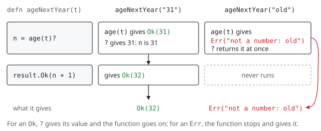

# Errors

In this chapter you handle what can go wrong: a file that isn't there, a text that isn't a number, input that `From` refuses.
In Cesia an error is a value that a function gives back, as any other result: an
[error value](glossary.md#error-value). There is no `try` and no [exception](glossary.md#exception): you see in the code
where each error goes. Rust works this way, with its `Result` and its `?`, and Go with the `err` that each call gives
back; Python, Java and JavaScript throw exceptions instead, which jump over the code between the error and the `try` that
catches it, so that reading a function doesn't tell which of its calls can fail.

## Ok and Err

A function that can fail gives a result: [result.Ok] around its value when all went well, or [result.Err] around what went wrong. A
result is always one of these two cases: a [sum type](glossary.md#sum-type). `.Value`
reads the one, `.Error` the other:

```cesia
use std/result
result.Ok(42) -->
result.Ok(42).Value -->
result.Err("no such user").Error -->
```

### A file that isn't there

[sys.Read], for instance, gives the text of a file in an `Ok`, or an `Err` that says why it couldn't. Its error is a dictionary
with a `Kind` and a `Message`. The block's first line, `use std/sys`, brings in the module of the system, as the chapter
[Packages](packages.md) shows. And the block runs with `--allow read`, since a program reads no file unless its command line
allows it: the chapter [Permissions](permissions.md) explains why.

```cesia allow=read
use std/sys
sys.Read("nowhere.txt") -->
```

### Your own results

Your own functions do the same. Here [text.Number] gives `missing` for a text that isn't a number, and `age` turns that into an
`Err` with a message for the user:

```cesia
use std/text
use std/value
defn age(t)
  n = text.Number(t)
  if value.IsMissing(n)
    return result.Err("not a number: $t")
  end
  result.Ok(n)
end
age("31") -->
age("old") -->
```

`missing` suits a value that may simply not be there, as a key of a dictionary. An `Err` says that something failed, and why.

## Looking at a result

[match] takes a result apart: `result.Ok(v)` gives the value its name, `result.Err(e)` the error.

```cesia
defn describe(t)
  match age(t)
    result.Ok(n) -> "$n years"
    result.Err(e) -> "refused: $e"
  end
end
describe("31") -->
describe("old") -->
```

### IsOk and IsErr

[result.IsOk] and [result.IsErr] only ask:

```cesia
result.IsOk(age("31")) -->
result.IsErr(age("old")) -->
```

### When an Err is a bug

`!` right after a result takes the value of an `Ok`, as `?` does. An `Err` there is a [bug](#errors-and-bugs): it stops
the program at the `!`, with the text of the error. Write it where an `Err` can only be a mistake of the program, as a
file that comes with it, a pattern written in the code, or a database opened at the start. It never leaves the function,
so it also works at the top of a file, where `?` can't go:

```cesia
age("31")! -->
age("31")! + 1 -->
```

```cesia fails
age("old")!
```

`x!` is short for [result.Unwrap]`(x)`, which does the same with a call, and stays the way to pass it as a function, as
to [list.Map]. Rust writes it `.unwrap()`, and Swift `!` after a value that may be `nil`:

```cesia
age("31")! --> result.Unwrap(age("31"))
```

The three ways to look into a result, side by side:

| Written | For an `Ok` | For an `Err` | Where |
|---|---|---|---|
| `x?` | its value | the function gives the `Err` back at once | inside a function |
| `x!` | its value | a bug: the program, or only its [fiber](fibers.md), stops at the `!` | anywhere |
| `match x` | the arm `result.Ok(v)` | the arm `result.Err(e)` | anywhere |

`!` keeps to its value as `?` does, with no space before it, and chains the same: `f(x)!.Name`, `rows[1]!`.
`a!=b` stays the comparison not-equal, read as one sign `!=`; `a! == b` unwraps `a`, then compares. After the type of what
a function gives, as in `Int!` ([Types](types.md)), `!` says that the function may fail; after a value, it says that this
value must not have failed.

`?` and `!` work at the end of a step of [then] too: `x then f()?` is `f(x)?`, and `x then f()!` is `f(x)!`.

```cesia
defn ageInMonths(t)
  n = t then age()?
  result.Ok(n * 12)
end
ageInMonths("31") -->
ageInMonths("old") -->
"31" then age()! then it + 1 -->
```

## A default

[result.UnwrapOr] gives the value of an `Ok`, or a default for an `Err`. Use it when an error has an obvious answer:

```cesia
result.UnwrapOr(0, age("31")) -->
result.UnwrapOr(0, age("old")) -->
```

## Passing an error on

Most of the time, a function that meets an error can't do better than give it to its caller: this is called
[error propagation](glossary.md#error-propagation). `?` after a result does that: for
an `Ok`, it gives the value, and the function goes on; for an `Err`, the function stops at once and gives that `Err`.

```cesia
defn ageNextYear(t)
  n = age(t)?
  result.Ok(n + 1)
end
ageNextYear("31") -->
ageNextYear("old") -->
```



### What ? is short for

`n = age(t)?` is short for these lines, which you can write yourself:

```cesia
defn ageNextYearLong(t)
  r = age(t)
  if result.IsErr(r)
    return r
  end
  n = r.Value
  result.Ok(n + 1)
end
ageNextYearLong("31") --> ageNextYear("31")
ageNextYearLong("old") --> ageNextYear("old")
```

### Only inside a function

`?` works inside a function only, since it leaves one: at the top of a file, `!` takes its place. Used on a value that is
no result, it stops the program: the message says to give a result.

```cesia fails
defn wrong(t)
  n = text.Number(t)?
  n
end
wrong("3")
```

## Steps on results

A few functions work on a result without taking it apart, and chain with [then]. [result.MapOk] changes the value of an `Ok`, and
[result.MapErr] the error of an `Err`. Each leaves the other kind as it is:

```cesia
age("31") then result.MapOk(it * 12) -->
age("old") then result.MapOk(it * 12) -->
age("old") then result.MapErr("age: $it") -->
```

### AndThen

[result.AndThen] chains a step that can fail too. It runs the function on the value of an `Ok`, and passes an `Err` along:

```cesia
defn adult(n)
  if n < 18
    return result.Err("too young: $n")
  end
  result.Ok(n)
end
age("31") then result.AndThen(adult) -->
age("12") then result.AndThen(adult) -->
age("old") then result.AndThen(adult) -->
```

### Collect

[result.Collect] turns a list of results into one: an `Ok` of all the values, or the first `Err`. Here a whole column of input is
checked at once:

```cesia
use std/list
result.Collect(list.Map(age, ["31", "12", "40"])) -->
result.Collect(list.Map(age, ["31", "old", "?"])) -->
```

## Errors and bugs

An `Err` is for what can happen while the program is right: the user typed a word, the file was deleted. A mistake in the
program itself is a bug, and a bug stops the program at once, with the line and the advice to fix it. You don't handle a bug:
you fix the code.

### Unwrap

[result.Unwrap] takes the value of an `Ok`, as [`!`](#when-an-err-is-a-bug) does, and is its plain form: a function, to
pass where a function goes. Use it only where an `Err` would be a bug, as a file that comes with your program:

```cesia
result.Unwrap(age("31")) -->
list.Map(result.Unwrap, [age("31"), age("40")]) -->
```

```cesia fails
result.Unwrap(age("old"))
```

### Panic and Assert

[bug.Panic] stops the program with your message, and [bug.Assert] stops it when a condition is false. Both are for what must never
happen:

```cesia fails
use std/bug
bug.Assert(value.Len([1, 2]) == 3, "the list should have three elements")
```

A reading of a dictionary key that isn't there, a field a struct doesn't have, a denied permission: each of these is a bug too,
and stops the program in the same way.

### What a bug prints

A bug stops the program with the exit code 1. It prints the file, the line and the column, the line itself with a mark
under the place, the message, and on a last line, when there is one, what to write instead; then the calls that led
there, the innermost first. The message comes from one table of the source, `src/lib/messages.ml`, so the same mistake
always reads the same way. A bug has a *kind*: `syntax`, `name`, `type`, `index`, `field`, `math`, `permission`, `io`
for a place the system can no longer give, as the current folder once another process removed it, which [path.Abs]
needs for a relative path, or `user` for [bug.Panic] and [bug.Assert]. In a [fiber](fibers.md), a bug stops that fiber
alone, and [fiber.Wait] gives an `Err` with its `Kind`, `Message`, `File` and `Line`.

## Next

Your programs say what went wrong, and where it goes. The next chapter, [Types](types.md), writes down what kind of
value each name holds, and Cesia checks it.
