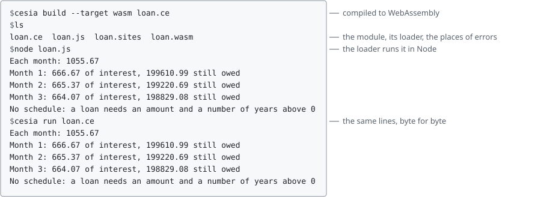

# Compiling to WebAssembly

In this chapter you compile a Cesia program to WebAssembly and run it in a web page and in Node, with the same output, the
same errors and the same numbers as `cesia run`. [WebAssembly](glossary.md#webassembly-and-wasmgc) is a format of code
that every current browser runs, near the speed of machine code, inside the page's [sandbox](glossary.md#sandbox).
`cesia build` compiles the program [ahead of time](glossary.md#ahead-of-time-compilation): the page holds your program
and the few functions of the runtime it uses, and no interpreter.

It compiles numbers, texts, lists, maps and dictionaries, functions and closures, `if`, `match` and loops, results, `?`
and `!`, errors, and [fibers](#fibers) with their channels; a program calls the [JavaScript](#javascript) of its page by
`js.Call`, and a long one leaves the page fluid. What it doesn't compile yet is an error at the build, at its place: see
[What it compiles](#what-it-compiles).

## The command

```bash
cesia build --target wasm file.ce
```

It writes three files beside `file.ce`: `file.wasm`, the module; `file.js`, its loader, which fetches the module, starts
it and writes what it prints; and `file.sites`, the places of its errors, which the loader reads at the first error only.
A program that uses packages gets them in the same module, compiled with it, and the JavaScript modules that it calls
by `js.Call` beside it ([JavaScript](#javascript)). Building again replaces them. `file.js` is plain JavaScript of 250
lines, with no package to install and no step after it.

When something can't be compiled yet, the build stops at its place, writes no file, and gives the exit code 1:

```text
area.ce:3:1: a declared result type isn't compiled to WebAssembly yet.
  3 | defn area(r Float) Float
    | ^
  cesia run runs it; cesia build --target wasm compiles part of Cesia for now.
```

An error of the program itself, a syntax error or a name that doesn't exist, is the error `cesia run` gives, at the
build. A `file.js` of the same name that `cesia build` didn't write stays as it is: the build stops with the exit code 2,
and says to move it or to build a file of another name.

## A first program in a page

The program computes the monthly payment of a loan, then, for the first months, how much of each payment goes to
interest and how much is still owed. A loan of nothing is an `Err`, which the program writes as such:

```cesia
(* loan.ce *)
use std/io
use std/result
use std/math
use std/list

(* The monthly payment of a loan, by the classic formula of annuities: p × r / (1 − (1 + r)^−n). *)
defn payment(principal, yearly, years)
  if principal <= 0 or years <= 0
    return result.Err("a loan needs an amount and a number of years above 0")
  end
  r = yearly / 12
  n = years * 12
  result.Ok(principal * r / (1 - (1 + r) ^ -n))
end

cents(x) = math.Round(x * 100) / 100

defn schedule(principal, yearly, years, months)
  pay = payment(principal, yearly, years)?
  owed = principal
  rows = []
  for m in 1..months
    interest = owed * yearly / 12
    owed = owed - (pay - interest)
    rows = list.Append({Month: m, Interest: cents(interest), Owed: cents(owed)}, rows)
  end
  result.Ok({Payment: cents(pay), Rows: rows})
end

defn show(s)
  io.Print("Each month: $(s.Payment)")
  for row in s.Rows
    io.Print("Month $(row.Month): $(row.Interest) of interest, $(row.Owed) still owed")
  end
end

for loan in [{Amount: 200000.0, Years: 25}, {Amount: 0, Years: 25}]
  match schedule(loan.Amount, 0.04, loan.Years, 3)
    result.Ok(s) -> show(s)
    result.Err(e) -> io.Print("No schedule: $e")
  end
end
```

Save it as `loan.ce` in a folder of its own, and build it:

```bash
cesia build --target wasm loan.ce
```

The folder now holds `loan.wasm` and `loan.js`. In Node 22 or later, the loader runs the program at once, and prints
the same lines as `cesia run loan.ce`:

```bash
node loan.js
```

In a page, the loader is a module script. Save this as `index.html` beside them:

```html
<!doctype html>
<meta charset="utf-8">
<title>Loan</title>
<p>The schedule is on the console: press F12.</p>
<script type="module" src="loan.js"></script>
```

A browser runs a module script only from a server, never from a file opened on the disk. [http.Static] serves the files
of a folder, so the server is two lines of Cesia. Save them as `serve.ce`:

```cesia norun
(* serve.ce: the files of this folder, on port 8080 of this machine. *)
use std/http
http.Serve(http.App() then http.Static("", "."))
```

Run it, with the right to read the folder and to listen on the port, then open <http://127.0.0.1:8080/index.html>:

```bash
cesia run --allow read=.,net=:8080 serve.ce
```

The console of the page (F12) shows the five lines that `cesia run loan.ce` prints, one message each. This page ran
so in Chrome 158, and `node loan.js` in Node 26, both the same as `cesia run loan.ce`, byte for byte.



## Output and errors

`io.Print` writes to the standard output in Node, and to the console of the page, one call of `console.log` per line.
An error writes what `cesia run` writes, the message, its line with the mark under it, the hint and the calls that led
there, to the standard error in Node, which then exits with the code 1, and through `console.error` in a page. Then the
program stops: nothing after the error runs. In `typo.ce`, the second call gives `cents` a text where a number was meant:

```text
(* typo.ce *)
use std/io
use std/math

cents(x) = math.Round(x * 100) / 100
io.Print(cents(1055.666))
io.Print(cents("1055.666"))
```

`node typo.js` writes, byte for byte as `cesia run typo.ce`:

```text
1055.67
typo.ce:4:25: Can't multiply the text "1055.666" by the number 100.
  4 | cents(x) = math.Round(x * 100) / 100
    |                         ^
  To put a value in a text, write "...$x" or value.Text(x).
  in cents (typo.ce:4)
```

The message comes from the same table as the interpreter's. The places of the errors, each line of code with the marks
under it, are in `typo.sites`, beside the module, which the loader reads only when an error happens: a page that runs
without one never loads it, and in a page the error is written once that file came.

The limits are those of `cesia run`: 10,000 calls deep at most, then the error `Limit "depth" reached.`, at the same
place, with the same calls named.

## What it compiles

| Compiled | Not yet |
|---|---|
| integers of 63 bits, checked as `cesia run` checks them; floats; true, false and missing | methods, interfaces |
| texts in UTF-8, `$` in texts, comparing them | types declared on parameters and results |
| lists, arrays of floats and of integers, ranges, comprehensions, `x[i]`, `x[a..b]`, a mask, `m[i, j]`, and their writes | `for x in` a channel |
| maps written as literals, their fields, `m["key"]`, `m.Name = v`; dictionaries of keys of numbers and texts, `in` | an index of three dimensions |
| functions, closures, functions as values, recursion | the packages of the system: files, processes, sockets but the WebSocket |
| `if`, `match` and its patterns, `for`, `while`, `return` | |
| `result.Ok`, `result.Err`, `?`, `!`, `bug.Panic` and errors | |
| [fibers](#fibers): `fiber.Spawn`, `Wait`, `Cancel`, `Channel`, `Send`, `Receive`, `Select`, `Close`; `sys.Sleep`, `sys.Now` | |
| [JavaScript](#javascript): `js.Call`, `std/websocket` through the WebSocket of the page, `http.Fetch` through its `fetch` | |

A map keeps its keys in the order of insertion. Past 8 keys it finds them by a table of their hashes, as the table of a
map of `cesia run` that nothing else holds ([How Cesia works](internals.md#maps-a-hash-table-then-a-hash-trie)), each
table with a seed drawn at random, so that nobody outside can choose keys that fall together, and drawn again when keys
fall together all the same. The 500,000 keys of `bench/maps.ce`, written one by one then each read once, take 413 ms in
Node, against 342 for `cesia run` ([Speed and size](#speed-and-size)). A write to a map that another variable holds
copies it whole, where `cesia run`'s trie copies one branch: a map of many keys that a function gets, writes and gives
back costs a copy at each call.

Of the standard library, these compile: `io.Print`; `math.Div`, `Mod`, `Abs`, `Floor`, `Ceil`, `Round`, `Sqrt`, `Exp`,
`Log`, `Sin`, `Cos`, `Tan`, `Asin`, `Acos` and `Atan`; `list.Sum`, `Append`, `Concat`, `Take`, `Skip`, `Reverse`,
`Fill`, `Max`, `Min`, `Sort`, `Order`, `Unique`, `Flatten`, `IndexOf`, `Any`, `All`, `Mean` and `Zip`; `matrix.Zeros`,
`Ones`, `Reshape`, `Matmul` and `Transpose`; `dict.Dict`, `Get`, `GetOr`, `Has`, `Put`, `Drop`, `Keys`, `Values` and
`Pairs`; `text.ByteLength`, `Byte`, `ByteSlice`, `ByteFind`, `StartsWith`, `EndsWith`, `Contains`, `Find`, `Slice`,
`Split`, `Join`, `Replace`, `Trim`, `Lower`, `Upper`, `Repeat`, `Chars`, `Code`, `Char`, `Number`, `Decimals`, `Str`,
`Numbers`, `FromNumbers`, `Bytes`, `FromBytes`, `PadLeft`, `PadRight`, `IsUtf8` and `ByteFindAny` (without `not`); `date.Local`, on the
clock of the page; `encode.Hex` and the rest of `std/encode`; `http.Fetch`; `json.Parse` and `json.Text`; `columns.Pick`, `Positions`, `Kind`, `Groups` and `Split`;
`regex.Test`; `random.Float`; `value.Len`, `Text`, `Equal`, `Size` and the tests `IsInt` to `IsMissing`; and the
packages written in Cesia, as `std/result`, `std/plot`, `std/check` or `std/websocket`, as far as they use what this
table compiles: a shape of `std/check` reads a form in a page as it reads the body of a request on the server.
The fibers have [their section](#fibers).

A page has no interpreter to call a native of: the compiler writes each one in WebAssembly, or, where Cesia says it as
well and fast enough, takes a version of its package written in Cesia, in `src/web/` of Cesia's sources: `list.ce`,
`json.ce`, `columns.ce`, `matrix.ce`, `regex.ce`, `text.ce`, `date.ce`, `encode.ce`, `http.ce` and `websocket.ce`, each function the
native of the same name, with its results and its errors. `regex.Test` runs the `RegExp` of the page: its patterns are
JavaScript's, which the common ones, classes, groups, anchors and repeats, share with Cesia's. `date.Local` reads the
clock of the page, in the browser's time zone. `http.Fetch` runs the page's `fetch`: a URL may be a path of the page's
origin, as `/auth/me`; the page's cookies of that origin go with it and its `Set-Cookie` stay the browser's; the browser
makes TLS and follows a redirection itself; `peer` is refused, since the browser doesn't tell the address it reached.

## Fibers

A program compiled to WebAssembly has the fibers of [std/fiber](fibers.md), with the same order as `cesia run`: a
fiber that waits lets the others run, the first ready first, and a program that waits for what nothing can bring stops
with the same error, `All fibers are waiting and nothing can wake them.` This one runs three fibers, a producer, a
channel of size 1 between them, and a wait with a timeout:

```cesia
(* relay.ce *)
use std/fiber
use std/io
use std/result
use std/sys

ch = fiber.Channel(size = 1)
producer = fiber.Spawn(defn ()
  for k in 1..3
    fiber.Send(k * 10, ch)
  end
  "sent"
end)
got = [result.Unwrap(fiber.Receive(ch)) for k in 1..3]
io.Print(got, fiber.Wait(producer))
io.Print(fiber.Receive(ch, timeout = 0.05).Error.Kind)
slow = fiber.Spawn(() -> sys.Sleep(10))
fiber.Cancel(slow)
io.Print(fiber.Wait(slow).Error.Kind)
```

`node relay.js` and a page print what `cesia run relay.ce` prints:

```text
[10, 20, 30] Ok("sent")
timeout
cancelled
```

*How.* WebAssembly has no fibers of its own yet, and four ways were weighed, each measured or tried:

- [JavaScript Promise Integration](glossary.md#javascript-promise-integration) (JSPI) lets a call of the module wait for
  a promise of JavaScript: the engine sets the whole stack of the call aside, frames, locals and all, and takes it up
  again when the promise is resolved. The main program and each fiber are such calls; a fiber that waits gives the
  loader a promise, which the loader resolves when its turn comes. Measured with a module of 155 bytes that waits
  100,000 times in a row: one wait and its return cost 0.17 µs in Node 26, 0.66 µs in Chrome 158 and 2.9 µs in Firefox
  160; a call that doesn't wait, 9 to 13 ns. A page waits for a socket or a click, not a million times a second, and code
  that doesn't wait pays nothing. It runs in Chrome since its version 137 (May 2025), in Firefox since 153 (July 2026),
  in Safari since 27 (fall 2026), and in Node 26.
- Asyncify, the pass of Binaryen that rewrites each function to unwind its stack into the memory and wind it back,
  can't hold the references of WasmGC that Cesia's values are: `wasm-opt --asyncify` on a module of WasmGC stops with
  "Asyncify does not yet support non-number types, like references".
- The proposal of stack switching (WasmFX), whose continuations are the fibers themselves, runs in no browser without
  a flag yet.
- A program turned by the compiler into a state machine, each function that may wait cut at its waits, would cost
  every call through a value, where the compiler can't know whether the callee waits, and every function of the
  standard library.

So JSPI. The scheduler is the loader's, as the interpreter's: one fiber runs at a time, in the order of the ready queue,
each next one started by a microtask of JavaScript; what wakes a fiber, a value sent, a timer, a message of a socket,
puts it at the end of that queue. A fiber that waits keeps its depth of calls and their sites, so that an error in it
names its own calls, as `cesia run` does; a panic in a fiber is the `Err` of its task, after its message.

*A page stays fluid.* A program runs on the thread of the page: while it computes, the page paints nothing and takes no
click. At each checkpoint of its fuel, every 62,500 steps, the loader looks at the clock; past 8 ms, the program waits
for the event loop of the page, which paints and takes its events, then goes on, first. That costs a message of
JavaScript, a few microseconds, and once a frame's time has passed it goes through the browser's next frame: Firefox,
between messages alone, paints 12 times a second. The 8 ms count from the time the program took the thread back: after
it gave the event loop back, or after it waited with nothing to run, as a page waits for its next event. Counted from
its last yield alone, as in the first version of this loader, the first checkpoint after a wait yielded at once, in the
middle of a frame, which then came a frame late: each of the 10 checkpoints of a scroll of the page of Ceres did so. And
every million steps, as `cesia run`, the fibers ready run.
Measured on a loop of 500 million square roots in one call, 2.1 seconds, with a page that counts its frames:

| | Chrome 158 | Firefox 160 |
|---|---|---|
| Frames while the loop runs, yielding | 128 to 130, each 16.7 ms apart | 141 to 144, 17.1 ms apart (p50), 33 to 50 (p99) |
| Frames while the loop runs, without yielding | 0 | 1 to 3 |
| Time of the loop, yielding / without | 2,150 to 2,187 / 2,112 to 2,120 ms | 2,457 to 2,505 / 2,302 to 2,325 ms |

The loop costs 2% more in Chrome and 8% in Firefox, and the page paints every frame. A `setTimeout` instead of the
message cost 55% more, waiting 4 ms each time; `scheduler.postTask` and `scheduler.yield()` left Firefox at 12 frames a
second, and the second Chrome too.

## JavaScript

[js.Call]`(module, name, args)` calls the function `name` of a module of JavaScript: a path
beside the Cesia file that calls it, as a `use` is, which `cesia build` puts beside the program, or `cesia:websocket` and
`cesia:regex`, the loader's own. Both are written in the call, as texts: the module's imports say all that a program
calls. A value goes to JavaScript as JavaScript takes it, and comes back the same way:

| Cesia | JavaScript |
|---|---|
| a text | a `Uint8Array` of its bytes, which `new TextDecoder().decode` makes a string; a string comes back as its UTF-8 |
| an integer, a float | a number; a whole number comes back as an integer |
| true, false, missing | `true`, `false`, `null`; `null` and `undefined` come back as missing |
| a list | an array |
| a channel of std/fiber | a handle: `send(value)` puts a value in it, `close()` closes it |

That is the one way out, a call, and the one way in, a channel that JavaScript fills: a click, a message, a timer of
the page comes to the program as a value on a channel, where a fiber waits for it. A dictionary or a function doesn't
cross: its JSON text does, with `json.Text`.

Here a button counts its clicks. The program asks `page.js` to send each click on its channel, then waits for them one
by one; between two, it waits, and the page is free:

```cesia norun
(* counter.ce: counts the clicks of a button of the page; between two, the program waits and the page is free. *)
use std/fiber
use std/js

clicks = fiber.Channel()
js.Call("./page.js", "Start", [clicks])
n = 0
while true
  _ = fiber.Receive(clicks)
  n += 1
  js.Call("./page.js", "Show", ["$n clicks"])
end
```

`page.js`, beside it, is the page's side:

```js
// page.js: the page's side of counter.ce. A text comes as the bytes of its UTF-8, a channel as a handle.
export function Start (clicks) {
  document.querySelector('button').addEventListener('click', () => clicks.send('click'))
}
export function Show (text) {
  document.querySelector('output').textContent = new TextDecoder().decode(text)
}
```

And `index.html`, which loads the program:

```html
<!doctype html>
<meta charset="utf-8">
<title>Counter</title>
<button>Click</button> <output>0 clicks</output>
<script type="module" src="counter.js"></script>
```

`cesia build --target wasm counter.ce`, then serve the folder as for [the loan](#a-first-program-in-a-page): three
clicks write `3 clicks`, in Chrome 158 and in Firefox 160.

*The WebSocket.* In a program compiled to WebAssembly, [websocket.Dial], `websocket.Send` and `websocket.Close`
are the WebSocket of the page, or of Node, through `cesia:websocket`, with the same arguments and results: `Dial` gives a
`Conn` whose `Messages` receives each message, and that closes when the connection ends. The browser makes the
handshake and sends its own headers, its cookies and its origin: `headers` must be empty there. A message comes whole,
and nothing waits for a full `Messages`, since a browser can't slow its server down.

Ceres, the user interface of the project, runs its pages so: compiled to WebAssembly, its loop waits on a channel of
the page's events, and its live screen is a WebSocket of the page.

## How it works

The compiler is a plugin of Cesia, `cesia_wasm.cmxs`, which only `cesia build` loads: `cesia run` never pays for it. It
loads the program as `cesia run` does, then compiles each function once for each kind of arguments it is called with, as
the JIT does: where the types are known, an integer is an `i64` of WebAssembly, with the checks of Cesia's 63 bits, and
a float an `f64`, both in the machine's registers; elsewhere, a value is a reference to an object of
[WasmGC](glossary.md#webassembly-and-wasmgc), the garbage collector of the browser itself, so that the module brings no
collector of its own. An integer that fits in 31 bits is an `i31ref`, a reference that holds the number with no object
behind it. A map literal shares its keys with every map of the same literal, and each read of a field remembers the keys
it met last and where the field was in them: the next read of a map of the same keys takes the value at once, as an
[inline cache](references.md#the-jit).

Three things make this code fast in the engines of the browsers:

- *Each loop in a function of its own.* V8 and SpiderMonkey, the engines of Chrome and Firefox, compile a function first
  with a quick compiler, then, once it has run a while, again with their optimizing one; a call that is running stays in
  its first code. So each `for` and `while` is a function of its own, a chunk, which runs at most 16,384 turns a call
  and is called again while the loop goes on: its next call runs the optimized code. The variables of the loop go in and
  come back, a `return` or a `?` inside leaves through the caller, and a float array that the loop only reads is taken
  once.
- *Typed maps.* A map literal whose keys are written in the code, and the kinds of whose values the compiler knows, as
  `{X: i * 1.0, N: i}`, is a struct of WasmGC with a field of each kind, an `f64` for a float, an `i64` for an integer,
  nothing in an object of its own. Everything else, `Print`, `==`, a pattern, `m.Name = v`, sees a map.
- *Guesses, tested first.* A statement that reads `p.X` of a variable `p`, where `p` may hold a typed map, the only one
  whose keys hold every field that the function reads of `p`, has two versions: the first tests that `p` holds that map,
  one test, then reads its fields as the numbers they are; the second, for when the test fails, is the general code. A
  variable that the function only ever sets to floats, as a sum, is guessed the same way. A wrong guess costs a test,
  never another result: the general version runs.

Each function of the runtime, the printing of a float or the arithmetic of two values of unknown type, goes into the
module at its first use only: a program that never divides has no division in its module, and only the types that its
code uses are written. `+`, `-`, `*`, `/` and the comparisons of two values whose types the compiler doesn't know call a
small function of the runtime, one for each operator, which tests first for two floats or two small integers: written
at each place, those tests made the page of Ceres 40% larger, and the engines put the code of a small function in
place where it runs hot, so its frames take as long. A function called with an argument left out, whose default is no
number, as `missing` or `false`, has one version for both: given or left out, that argument is a value, and the version
tests which. When the module is written, only what its exports reach goes in: a function, a global or a data segment
that no code names is left out. The texts of messages are bytes of a data segment, one byte each. The module and the
loader are written by Cesia itself, with no tool of WebAssembly to install.

A program holds the code that its calls reach, and so of what it may run: a function that a branch calls by its name
comes with it, though the branch never runs. [std/plot] keeps in each layer the functions of its kind, put there by the
function that made the layer, as `plot.Bars` or `plot.Surface`, where it looked them up by the kind's name: a page that
draws bars holds the code of bars, and none of a surface in three dimensions, which made most of the module.

## Speed and size

The six programs of [Speed](speed.md#computing), `maps` among them, and `bench/points.ce`, 1,000 maps `{X, V}` each
moved 2,000 times and written back into their list, compiled to WebAssembly and run in Node 26.13 (V8), in Chrome 158
(V8) and in Firefox 160 (SpiderMonkey), both headless, beside the same programs written in JavaScript, run in the same
engine, and beside `cesia run`. One machine, an Intel Core i7-4720HQ of 2015, 8 logical cores, Linux 7.2, on 2026-11-25,
while other work ran on it (load 2.0 to 3.0): milliseconds, medians of 5 runs, the sides taken in turn so that the load
fell on each, a new process for each run in Node and a new browser for each round. The times are those of the program
alone, once its module is loaded; `cesia run`'s is the whole command, its start of about 5 ms included. The faster of
each engine is in bold.

| Program | Node, WebAssembly | Node, JavaScript | Chrome, WebAssembly | Chrome, JavaScript | Firefox, WebAssembly | Firefox, JavaScript | `cesia run` |
|---|---:|---:|---:|---:|---:|---:|---:|
| `fib` | **121** | 141 | **116** | 120 | **146** | 187 | 63 |
| `mandel` | 58 | **57** | 58 | **54** | 107 | **56** | 64 |
| `matmul` | 171 | **61** | 198 | **62** | 231 | **84** | 48 |
| `structs` | 151 | **142** | 138 | **112** | 314 | **109** | 42 |
| `dyn` | 310 | **137** | 260 | **129** | 385 | **116** | 64 |
| `points` | 53 | **34** | 41 | **29** | 98 | **37** | 54 |
| `maps` | **413** | 583 | **349** | 414 | 517 | **479** | 342 |

The first slice of this compiler took, in Node, 124 ms for `fib`, 91 for `mandel`, 904 for `matmul`, 923 for `structs`,
1,103 for `dyn` and 148 for `points`, and `maps` hadn't ended after 100 seconds.

**Where WebAssembly wins.** On calls of functions on numbers: `fib`, 30 million calls on integers of 63 bits checked at
each step, in the three engines, against JavaScript, whose numbers are floats with no check. On a map of many keys:
`maps`, 500,000 keys of text, in Node and Chrome. And `mandel` and `structs` come within 2 to 24% of JavaScript in Node
and Chrome.

**Where JavaScript wins, and why.**

- *The checks of `matmul`.* Each of its 27 million turns reads two cells of arrays: Cesia checks each index against the
  count of the array, then WebAssembly checks it again against its store, and each `i * n + k + 1` is checked against
  the 63 bits of Cesia's integers. V8 knows from the loop that the index stays in its array and adds in 32 bits: 2.7 to
  3.2 times.
- *A call through a value.* `dyn` calls one of two functions taken from a list at each of its 10 million turns: the call
  tests that the value is a function of that arity, counts the depth of the calls, and gives back its float in an object
  of its own. V8 sees the two functions that the call meets, puts their code in the loop and keeps the float in a
  register: 2.0 to 3.3 times. An entry of a function value for the kinds its arguments have at the run would take the
  float with no object; it isn't made yet.
- *A new map at each turn.* `points` makes a map at each of its 2 million turns, a struct of WasmGC now, and writes it
  into its list, which tests that nothing else holds the list and that the cell is in it; V8 writes its object in place:
  1.4 to 2.6 times.
- *Firefox.* SpiderMonkey ran these modules 1.2 to 2.4 times slower than Chrome, where its JavaScript keeps up with
  V8's. Two causes, found on `mandel`, whose loop took 107 to 147 ms in Firefox, where the same loop written by hand in
  WebAssembly took 55 to 60 in Firefox and in Chrome alike:
  - *A call after a loop.* Each chunk of a loop counted the fuel of its turns at its end, and called the runtime's
    `refuel` when it ran out, with the loop's variables alive across that call, since it gives them back after it. Ion,
    the optimizing compiler of SpiderMonkey, then kept them in memory through the whole loop: with Ion alone, `mandel`
    took 112 to 125 ms with that call and 61 to 67 without it, and nothing else of the chunk counted, neither the check
    of 63 bits nor the count of the turns. A chunk now only counts its fuel, and its caller refuels.
  - *Optimized code that comes late.* Firefox runs a function first in its baseline code, then in Ion's once Ion has
    compiled it, on a thread of its own, which waits while the machine is busy: under load, its times came near those
    of its baseline code alone, `mandel` 125 to 136 ms where Ion alone takes 60.
- Rust or C compiled to WebAssembly, with no check of overflow, weren't measured here.

*Firefox, before and after the first cause*, the same day (load 2.7 to 2.4), medians of 3 rounds, in ms:

| Firefox 160, WebAssembly | `fib` | `mandel` | `matmul` | `structs` | `dyn` | `points` | `maps` |
|---|---:|---:|---:|---:|---:|---:|---:|
| Before | 246 | 133 | 510 | 364 | 460 | 121 | 790 |
| After | 220 | 76 | 501 | 325 | 605 | 138 | 769 |
| Firefox's JavaScript | 236 to 244 | 56 to 58 | 112 to 121 | 120 to 121 | 123 to 150 | 38 to 40 | 538 to 600 |

The others moved within the noise of a busy machine, as Firefox's JavaScript moved, `dyn` 123 to 150 ms; Chrome and
Node didn't move. Where Firefox's JavaScript keeps up with V8's and its WebAssembly doesn't, as on `matmul` and
`structs`, the cause wasn't found in this slice.

And `cesia run`, with its JIT, wins every row but `points` and `mandel` against WebAssembly, though its time holds its
start.

**Size.** What a server sends, in bytes, plain and compressed by Brotli at its quality 11, as a server compresses files
once ahead of time, beside the first slice of this compiler:

| Program | Module | Module, Brotli | First slice | First slice, Brotli | JavaScript source, Brotli |
|---|---:|---:|---:|---:|---:|
| hello world, `io.Print("Hello from Cesia")` | 295 | 226 | 431 | 321 |  |
| `fib` | 2,117 | 1,178 | 2,615 | 1,173 | 79 |
| `mandel` | 3,099 | 1,527 | 2,928 | 1,409 | 238 |
| `matmul` | 11,573 | 4,784 | 11,194 | 3,243 | 210 |
| `structs` | 13,051 | 5,675 | 13,448 | 4,393 | 250 |
| `dyn` | 11,541 | 4,784 | 11,461 | 4,053 | 199 |
| `points` | 12,367 | 5,413 | 11,754 | 4,271 | 196 |
| `maps` | 11,658 | 5,124 | 10,934 | 4,122 | 135 |
| `loan.ce` of this chapter | 15,414 | 6,151 | 18,988 | 5,762 |  |

The loader, `NAME.js`, adds 10,820 bytes, 3,813 with Brotli, with its fibers and its calls of JavaScript, where the
first slice's added 3,820 and 1,525: it comes without the comments of its source. A module holds only the types its code uses, and the text of a message takes a byte a byte. A
loop in a function of its own, and a statement in two versions, make a program of loops larger, as `loan.ce`. A program
that prints a list, a map or a value of a type the compiler doesn't know brings the printer of every value; JavaScript's
source stays smaller, since its engine is in the browser already.

*A page of Ceres.* The invoices page of Ceres, the user interface of the project, compiled to WebAssembly and live from
its app: a form, a list that the app keeps up to date, a graph of `std/plot` and a table of 100,000 rows. Measured by
`tests/web/frames.html` of Ceres, on the same machine, headless, while the wheel scrolls the table 200 notches, one
every 16 ms, and while a field is typed in: for each frame, the time from the browser's frame to the page painted, and
the two parts of it, the wait before the browser calls the page and the page's own work, WebAssembly and WebGL; medians
of 3 rounds (load 4.1 to 5.6, other work running), each a new browser. Chrome draws without a GPU, as headless Chrome
does by default, and with the GPU of the machine (`--use-angle=gl`):

| | Chrome 158, no GPU | Chrome 158, GPU | Firefox 160 |
|---|---|---|---|
| A frame while scrolling, p50 / p99 | 8.7 to 9.5 / 18 to 26.5 ms | 1.4 to 1.5 / 3.6 to 7.2 ms | 1.8 to 2.5 / 4.5 to 19.6 ms |
| Of it, the page's work, p50 / p99 | 1.7 to 2.6 / 7.9 to 11.4 ms | 1.1 to 1.2 / 3.2 to 5.8 ms | 1.6 to 2.1 / 3.1 to 4.9 ms |
| Of it, the wait for the browser's call, p50 | 5.7 to 7.2 ms | 0.3 ms | 0.2 to 0.8 ms |
| Of it, WebGL, p50 | 0.9 to 1.4 ms | 0.6 to 0.8 ms | 0.7 to 0.8 ms |
| A frame while typing, the page's work, p50 / p99 | 1.0 to 1.5 / 1.3 to 2.5 ms | 0.9 to 5.0 / 1.6 to 25 ms | 1.1 to 1.3 / 3.2 to 3.6 ms |
| Frames of the browser while scrolling, p50 / p99 apart | 16.7 to 33.3 / 50 ms | 16.7 / 16.8 ms | 17.1 / 17.1 to 100.5 ms |
| Frames painted for the 200 notches | 128 to 154 | 199 to 200 | 175 to 200 |

The first measures of this page, before the changes of this section, gave a frame while scrolling 8.2 to 9.7 / 19 to 35
ms in Chrome without a GPU and 1.7 to 2.2 / 7 to 19 ms in Firefox. A round that took a frame of 25 ms or more in Chrome
with the GPU, or of 100 ms in Firefox, met the other work of the machine.

**Chrome's frames.** Those first measures took a frame from the time that `requestAnimationFrame` gives its callback,
and found Chrome 4 times slower than Firefox while scrolling. Chrome gives the start of its frame, which it
takes before it runs the frame; Firefox, the time it calls. Taken at the callback, Chrome had waited 2.6 to 5.4 ms (p50),
Firefox 0.2. Without a GPU, Chrome draws with SwiftShader, WebGL in software: a trace of the page shows its compositor 31
ms (p50) from a frame submitted to the frame shown, so that the next frame starts late; on an empty page, the wait is
0.3 ms, and with the GPU too. The page's own work was never slower in Chrome: 1.9 ms (p50) against Firefox's 2.0, its
program 4.6 to 5.7 ms of the thread for each notch against 4.0 to 4.3, and each function of the module as fast in V8
as in SpiderMonkey or faster, in the profiles of both. `frames.html` now gives the wait and the work apart. The p99 of
18 to 35 ms, in both, came from the yields of the first loader, each a frame late (see *A page stays fluid*): Firefox's
fell to 3 to 4 ms.

**What a notch costs.** Each notch of the wheel takes the page about 1 ms to take the event, then 3.5 ms at the frame:
1.6 to the canvas painted, then 2 for the tree of semantics, its JSON and the hidden DOM that screen readers read, which
Chrome then lays out, 1.5 ms more of style, layout and paint.

**Size, part by part.** What the page sends, in bytes, plain and with Brotli at its quality 11:

| Part | Bytes | Brotli |
|---|---:|---:|
| `browser.wasm`, the module | 388,054 | 103,145 |
| its code, of `std/plot` | 147,799 | about 41,800 |
| its code, of Ceres | 105,114 | about 29,700 |
| its code, of the runtime | 37,466 | about 10,600 |
| its code, of the page's versions of `std/json`, `std/list`, `std/columns`, `std/websocket` | 17,334 | about 4,900 |
| its code, of the page, its start, `std/list`, `std/result` and `std/dict` | 10,630 | about 3,000 |
| its constants (texts, keys, functions), data, types and imports | 69,711 | about 13,200 |
| `browser.js`, the loader | 10,834 | 3,805 |
| `ceres.js`, the glue of Ceres | 18,402 | 6,053 |
| `browser.sites`, the places of errors, fetched at the first error only | 706,991 | 100,836 |

The code's parts are measured with `CESIA_WASM_NAMES=1`, whose names say each function's file; they share the Brotli of
the code, 89,945 bytes, by their bytes. The module was 1,023,363 bytes, 177,562 with Brotli. These changes cut it:

- *The kinds of graphs that a program makes, and no other* (see *How it works*): 628,800 bytes, 120,476 with Brotli.
- *The operators of two values in functions of the runtime*: 412,683 and 103,742.
- *No version for a default*: 390,041 and 103,089.
- *A chunk that leaves its refuel to its caller* (see *Firefox* above): 388,054 and 103,145.

A module that holds only what its exports reach cut 715 bytes of it: the compiler already compiles a function only once
a call reaches it. What is left of `std/plot` draws bars, their axes and their ticks, and the options of `plot.Of` and
`plot.Scene` that the page doesn't use, which the code reaches through a function value: a polar graph, 28 KB, a note,
ticks given, the names at the ends of lines, the marks of a point. The bytes left belong to what the page runs.

**wasm-opt.** Binaryen 133's `wasm-opt` on this module: `-Oz` gives 343,984 bytes, 102,155 with Brotli, 1% less;
`--closed-world --gufa -Oz`, which takes the module as all there is and follows each value through it, 312,754 and
93,602, 9% less, in 2.7 s, and the page runs the same in Chrome and Firefox. With `-all`, it writes the exact types of
a proposal that Chrome refuses: name the features, `--enable-gc --enable-reference-types --enable-bulk-memory
--enable-sign-ext --enable-nontrapping-float-to-int --enable-tail-call --enable-multivalue`. `cesia build` doesn't run
it: Cesia brings no tool of WebAssembly to install.

**First paint.** From the start of the page to its first frame painted, and its parts, which the loader and the glue of
Ceres mark, before the changes below and now, 3 to 4 loads each in one browser:

| | Chrome 158, no GPU | Chrome 158, GPU | Firefox 160 |
|---|---|---|---|
| First paint, the first page of a new browser, before / now | 557 to 581 / 496 to 499 ms | 1,379 / 1,393 ms | 447 to 499 / 193 to 239 ms |
| First paint, the next pages, before / now | 263 to 343 / 157 to 286 ms | 77 to 142 / 80 to 137 ms | 107 to 162 / 100 to 157 ms |
| Of it, WebGL set up, `getContext("webgl2")` | 117 to 431 ms | 8 to 71 ms, 1,266 at the first | 6 to 17 ms |
| Of it, before: the module fetched, compiled and started | 39 to 56 ms | 30 to 33 ms | 71 to 105 ms |

The loader now asks for the module and for the JavaScript modules that `js.Call` names at once, and compiles the module
while its bytes arrive, with `WebAssembly.compileStreaming`, when the server says `application/wasm`, as [http.Static]
now does for a `.wasm`. The glue of Ceres sets WebGL up as it loads, while the module compiles: in Chrome, the module is
compiled by the time WebGL is ready. Chrome without a GPU spends most of a first paint in setting WebGL up, which no page
shortens; with the GPU, as a browser on a desk has it, and in Firefox, a first paint takes 80 to 160 ms. The first page
of a new browser takes longer: 1.3 s with Chrome's GPU, the time its process of the GPU takes to start, and Firefox,
which compiled its module after it came whole, now paints it in half the time.

**Beside the frameworks of JavaScript.** The pages of the js-framework-benchmark of Stefan Krause, a table of 1,000 rows
that each framework builds and changes, as they are built for it, in bytes, plain and with Brotli:

| Page | Bytes | Brotli |
|---|---:|---:|
| Solid 1.9 | 11,563 | 4,359 |
| Svelte 5 | 26,953 | 9,716 |
| Angular 22 | 148,909 | 45,950 |
| React 19 | 194,643 | 52,423 |
| Leptos 0.7, Rust compiled to WebAssembly | 193,500 | 49,266 |
| Yew 0.23, Rust compiled to WebAssembly | 206,786 | 57,743 |
| The invoices page of Ceres: module, loader and glue | 417,290 | 113,003 |

Those pages give the browser their elements, which it lays out and writes with its own engine; Ceres lays out and
paints its page itself, on a canvas, from its rules of layout to the virtual rows of its table, and its page holds a
graph and a table kept live from a server. A graph would bring a library of its own to those pages. The page of Ceres
is 2.2 to 2.3 times React's or Leptos's, and 26 times Solid's.

## Further reading

- Andreas Haas and others, *Bringing the Web up to Speed with WebAssembly*, 2017: the design of WebAssembly, its types
  and its validation.
- Wasm 3.0 and its proposal of garbage collection, 2025: the structs, arrays and `i31ref` that Cesia's values are made of.
- L. Peter Deutsch and Allan M. Schiffman, *Efficient Implementation of the Smalltalk-80 System*, 1984: the inline
  cache, which each read of a field keeps.
- Craig Chambers, David Ungar and Elgin Lee, *An Efficient Implementation of SELF*, 1989: maps, the layout shared by
  the objects of one shape, which V8 calls hidden classes; Cesia's typed maps in a page.
- Python 3.6's compact dict, after Raymond Hettinger, and Donald E. Knuth, *The Art of Computer Programming*, volume 3,
  section 6.4: the table of a map past 8 keys, and what its probes cost.
- Guy L. Steele Jr., Doug Lea and Christine H. Flood, *Fast Splittable Pseudorandom Number Generators*, 2014:
  SplitMix64, which draws the seed of each table.
- The WebAssembly Community Group's proposal *JavaScript Promise Integration*, and V8's *Introducing the WebAssembly
  JavaScript Promise Integration API*, 2024: the fibers of a page.
- Luna Phipps-Costin and others, *Continuing WebAssembly with Effect Handlers*, 2023: stack switching, the fibers that
  WebAssembly may have one day.

Each with its link in [References](references.md#webassembly), [The JIT](references.md#the-jit),
[Values and maps](references.md#values-and-maps) and [Tests](references.md#tests).

## Next

The next chapter, [C and C++](c.md), calls the libraries of the system from Cesia.
