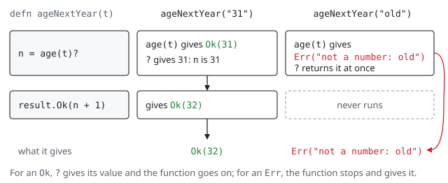

# Erreurs

Dans ce chapitre, vous traitez ce qui peut mal tourner : un fichier qui n'est pas là, un texte qui n'est pas un nombre,
des données reçues que `From` refuse. En Cesia, une erreur est une valeur qu'une fonction rend, comme n'importe quel autre
résultat : une [error value](glossary.md#error-value). Il n'y a ni `try` ni [exception](glossary.md#exception) : vous
voyez dans le code où va chaque erreur. Rust marche ainsi, avec son `Result` et son `?`, et Go avec le `err` que rend
chaque appel ; Python, Java et JavaScript lancent plutôt des exceptions, qui sautent par-dessus le code placé entre
l'erreur et le `try` qui l'attrape : lire une fonction ne dit donc pas lesquels de ses appels peuvent échouer.

## Ok et Err

Une fonction qui peut échouer donne un résultat : [result.Ok] autour de sa valeur quand tout s'est bien passé, ou
[result.Err] autour de ce qui a mal tourné. Un résultat est toujours l'un de ces deux cas : c'est un
[sum type](glossary.md#sum-type). `.Value` lit l'un, `.Error` l'autre :

```cesia
use std/result
result.Ok(42) -->
result.Ok(42).Value -->
result.Err("no such user").Error -->
```

### Un fichier qui n'est pas là

[sys.Read], par exemple, donne le texte d'un fichier dans un `Ok`, ou un `Err` qui dit pourquoi elle n'a pas pu. Son
erreur est un dictionnaire avec un `Kind` et un `Message`. La première ligne du bloc, `use std/sys`, fait venir le
module du système, comme le montre le chapitre [Packages](packages.md). Et le bloc tourne avec `--allow read`, puisqu'un
programme ne lit aucun fichier si sa ligne de commande ne le permet pas : le chapitre [Permissions](permissions.md)
explique pourquoi.

```cesia allow=read
use std/sys
sys.Read("nowhere.txt") -->
```

### Vos propres résultats

Vos propres fonctions font de même. Ici, [text.Number] donne `missing` pour un texte qui n'est pas un nombre, et `age`
en fait un `Err` avec un message pour l'utilisateur :

```cesia
use std/text
use std/value
defn age(t)
  n = text.Number(t)
  if value.IsMissing(n)
    return result.Err("not a number: $t")
  end
  result.Ok(n)
end
age("31") -->
age("old") -->
```

`missing` convient à une valeur qui peut tout simplement ne pas être là, comme une clé d'un dictionnaire. Un `Err` dit
que quelque chose a échoué, et pourquoi.

## Regarder un résultat

[match] défait un résultat : `result.Ok(v)` donne son nom à la valeur, `result.Err(e)` à l'erreur.

```cesia
defn describe(t)
  match age(t)
    result.Ok(n) -> "$n years"
    result.Err(e) -> "refused: $e"
  end
end
describe("31") -->
describe("old") -->
```

### IsOk et IsErr

[result.IsOk] et [result.IsErr] ne font que poser la question :

```cesia
result.IsOk(age("31")) -->
result.IsErr(age("old")) -->
```

### Quand un Err est un bug

`!` juste après un résultat en sort la valeur d'un `Ok`, comme `?` : c'est un *unwrap*, « déballer » en anglais. Un
`Err` à cet endroit est un [bug](#erreurs-et-bugs) : il arrête le programme au `!`, avec le texte de l'erreur.
Écrivez-le là où un `Err` ne peut être qu'une erreur du programme, comme un fichier livré avec lui, un motif écrit dans le
code, ou une base de données ouverte au départ. Il ne sort jamais de la fonction, et marche donc aussi en haut d'un
fichier, là où `?` ne peut pas aller :

```cesia
age("31")! -->
age("31")! + 1 -->
```

```cesia fails
age("old")!
```

`x!` est la forme courte de [result.Unwrap]`(x)`, qui fait la même chose par un appel, et reste la façon de passer
cette opération comme fonction, par exemple à [list.Map]. Rust l'écrit `.unwrap()`, et Swift `!` après une valeur qui peut être `nil` :

```cesia
age("31")! --> result.Unwrap(age("31"))
```

Les trois façons de regarder dans un résultat, côte à côte :

| Écrit | Pour un `Ok` | Pour un `Err` | Où |
|---|---|---|---|
| `x?` | sa valeur | la fonction rend l'`Err` tout de suite | dans une fonction |
| `x!` | sa valeur | un bug : le programme s'arrête au `!`, ou seulement sa [fiber](fibers.md), le fil où il tourne | partout |
| `match x` | la branche `result.Ok(v)` | la branche `result.Err(e)` | partout |

`!` reste collé à sa valeur comme `?`, sans espace avant lui, et s'enchaîne de la même façon : `f(x)!.Name`, `rows[1]!`.
`a!=b` reste la comparaison « différent de », lue comme un seul signe `!=` ; `a! == b` fait l'unwrap de `a`, puis
compare. Après le type de ce que donne une fonction, comme dans `Int!` ([Types](types.md)), `!` dit que la fonction peut
échouer ; après une valeur, il dit que cette valeur ne doit pas avoir échoué.

`?` et `!` marchent aussi au bout d'une étape de [then] : `x then f()?` est `f(x)?`, et `x then f()!` est `f(x)!`.

```cesia
defn ageInMonths(t)
  n = t then age()?
  result.Ok(n * 12)
end
ageInMonths("31") -->
ageInMonths("old") -->
"31" then age()! then it + 1 -->
```

## Une valeur par défaut

[result.UnwrapOr] donne la valeur d'un `Ok`, ou une valeur par défaut pour un `Err`. Servez-vous-en quand une erreur a
une réponse évidente :

```cesia
result.UnwrapOr(0, age("31")) -->
result.UnwrapOr(0, age("old")) -->
```

## Faire suivre une erreur

La plupart du temps, une fonction qui rencontre une erreur ne peut pas faire mieux que la donner à son appelant : cela
s'appelle l'[error propagation](glossary.md#error-propagation). Un `?` après un résultat fait cela : pour un `Ok`, il
donne la valeur, et la fonction continue ; pour un `Err`, la fonction s'arrête tout de suite et donne cet `Err`.

```cesia
defn ageNextYear(t)
  n = age(t)?
  result.Ok(n + 1)
end
ageNextYear("31") -->
ageNextYear("old") -->
```



### Ce que ? remplace

`n = age(t)?` est la forme courte de ces lignes, que vous pouvez écrire vous-même :

```cesia
defn ageNextYearLong(t)
  r = age(t)
  if result.IsErr(r)
    return r
  end
  n = r.Value
  result.Ok(n + 1)
end
ageNextYearLong("31") --> ageNextYear("31")
ageNextYearLong("old") --> ageNextYear("old")
```

### Seulement dans une fonction

`?` ne marche que dans une fonction, puisqu'il en sort : en haut d'un fichier, `!` prend sa place. Utilisé sur une valeur
qui n'est pas un résultat, il arrête le programme : le message dit de donner un résultat.

```cesia fails
defn wrong(t)
  n = text.Number(t)?
  n
end
wrong("3")
```

## Des étapes sur des résultats

Quelques fonctions travaillent sur un résultat sans le défaire, et s'enchaînent avec [then]. [result.MapOk] change la
valeur d'un `Ok`, et [result.MapErr] l'erreur d'un `Err`. Chacune laisse l'autre cas tel qu'il est :

```cesia
age("31") then result.MapOk(it * 12) -->
age("old") then result.MapOk(it * 12) -->
age("old") then result.MapErr("age: $it") -->
```

### AndThen

[result.AndThen] enchaîne une étape qui peut échouer elle aussi. Elle applique la fonction à la valeur d'un `Ok`, et
fait suivre un `Err` tel quel :

```cesia
defn adult(n)
  if n < 18
    return result.Err("too young: $n")
  end
  result.Ok(n)
end
age("31") then result.AndThen(adult) -->
age("12") then result.AndThen(adult) -->
age("old") then result.AndThen(adult) -->
```

### Collect

[result.Collect] change une liste de résultats en un seul : un `Ok` de toutes les valeurs, ou le premier `Err`. Ici,
toute une colonne de données reçues est vérifiée d'un coup :

```cesia
use std/list
result.Collect(list.Map(age, ["31", "12", "40"])) -->
result.Collect(list.Map(age, ["31", "old", "?"])) -->
```

## Erreurs et bugs

Un `Err` sert à ce qui peut arriver alors que le programme est juste : l'utilisateur a tapé un mot, le fichier a été
effacé. Une faute dans le programme lui-même est un bug, et un bug arrête tout de suite le programme, avec la ligne et
le conseil pour le corriger. On ne traite pas un bug : on corrige le code.

### Unwrap

[result.Unwrap] prend la valeur d'un `Ok`, comme [`!`](#quand-un-err-est-un-bug), dont il est la forme simple : une
fonction, à passer là où va une fonction. Ne vous en servez que là où un `Err` serait un bug, comme pour un fichier livré
avec votre programme :

```cesia
result.Unwrap(age("31")) -->
list.Map(result.Unwrap, [age("31"), age("40")]) -->
```

```cesia fails
result.Unwrap(age("old"))
```

### Panic et Assert

[bug.Panic] arrête le programme avec votre message, et [bug.Assert] l'arrête quand une condition est fausse. Les deux
servent à ce qui ne doit jamais arriver :

```cesia fails
use std/bug
bug.Assert(value.Len([1, 2]) == 3, "the list should have three elements")
```

La lecture d'une clé qui n'est pas dans un dictionnaire, un champ qu'une struct n'a pas, une permission refusée : chacun
de ces cas est aussi un bug, et arrête le programme de la même façon.

### Ce qu'affiche un bug

Un bug arrête le programme avec l'exit code 1 (le nombre qu'un programme rend à celui qui l'a lancé). Il affiche le
fichier, la ligne et la colonne, la ligne elle-même avec une marque sous l'endroit, le message, et, sur une dernière
ligne, quand il y en a une, ce qu'il faut écrire à la place ; puis les appels qui ont mené là, le plus intérieur
d'abord. Le message vient d'une seule table des sources, `src/lib/messages.ml` : la même faute se lit donc toujours de
la même façon. Un bug a un *kind*, une sorte : `syntax`, `name`, `type`, `index`, `field`, `math`, `permission`, `io`
pour un lieu que le système ne peut plus donner, comme le dossier courant qu'un autre processus a supprimé, dont
[path.Abs] a besoin pour un chemin relatif, ou `user` pour [bug.Panic] et [bug.Assert]. Dans une [fiber](fibers.md) (une
fonction qui tourne à côté des autres dans le même programme), un bug n'arrête que cette fiber, et [fiber.Wait] donne un
`Err` avec son `Kind`, son `Message`, son `File` et sa `Line`.

## La suite

Vos programmes disent ce qui a mal tourné, et où l'erreur va. Le chapitre suivant, [Types](types.md), écrit la sorte de
valeur que garde chaque nom, et Cesia la vérifie.
