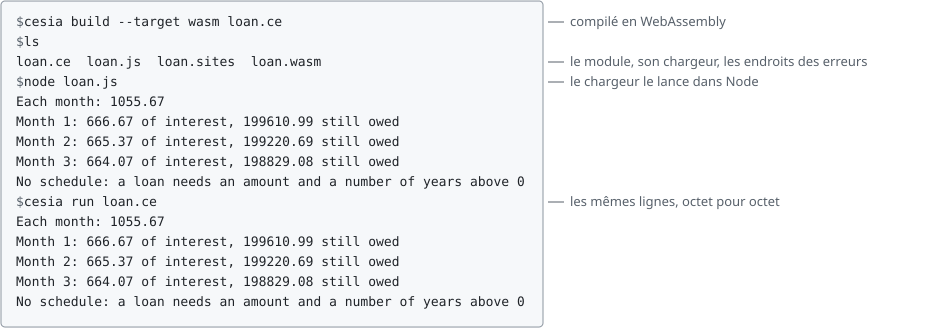

# Compiler vers WebAssembly

Dans ce chapitre, vous compilez un programme Cesia vers WebAssembly et vous le lancez dans une page web et dans Node, avec
la même sortie, les mêmes erreurs et les mêmes nombres que `cesia run`. [WebAssembly](glossary.md#webassembly-and-wasmgc)
est un format de code que tous les navigateurs actuels exécutent, près de la vitesse du code machine, dans la
[sandbox](glossary.md#sandbox) de la page (l'enceinte d'où le code ne peut pas sortir). `cesia build` compile le programme
[ahead of time](glossary.md#ahead-of-time-compilation), c'est-à-dire avant qu'il tourne : la page contient votre
programme et les quelques fonctions du runtime (le code de soutien qui accompagne tout programme) dont il se sert, et
aucun interpréteur.

Il compile les nombres, les textes, les listes, les maps et les dictionnaires, les fonctions et les closures, `if`,
`match` et les boucles, les résultats, `?` et `!`, les erreurs, et les [fibers](#fibers) avec leurs channels ; un
programme appelle le [JavaScript](#javascript) de sa page par `js.Call`, et un programme long laisse la page fluide. Ce
qu'il ne compile pas encore est une erreur au build, à sa place : voir [Ce qu'il compile](#ce-quil-compile).

## La commande

```bash
cesia build --target wasm file.ce
```

Elle écrit trois fichiers à côté de `file.ce` : `file.wasm`, le module ; `file.js`, son loader (le petit script qui va
chercher le module, le démarre et écrit ce qu'il affiche) ; et `file.sites`, les places de ses erreurs, que le loader ne
lit qu'à la première erreur. Un programme qui utilise des packages les reçoit dans le même module, compilés avec lui, et
les modules JavaScript qu'il appelle par `js.Call` à côté de lui ([JavaScript](#javascript)). Un nouveau build les
remplace. `file.js` est du JavaScript simple de 250 lignes, sans package à installer ni étape après lui.

Quand quelque chose ne peut pas encore être compilé, le build s'arrête à sa place, n'écrit aucun fichier, et donne
l'exit code 1 :

```text
area.ce:3:1: a declared result type isn't compiled to WebAssembly yet.
  3 | defn area(r Float) Float
    | ^
  cesia run runs it; cesia build --target wasm compiles part of Cesia for now.
```

Une erreur du programme lui-même, une erreur de syntaxe ou un nom qui n'existe pas, est l'erreur que donne `cesia run`,
au build. Un `file.js` du même nom que `cesia build` n'a pas écrit reste tel qu'il est : le build s'arrête avec l'exit
code 2, et dit de le déplacer ou de compiler un fichier d'un autre nom.

## Un premier programme dans une page

Le programme calcule la mensualité d'un prêt, puis, pour les premiers mois, ce que chaque mensualité paie d'intérêts et
ce qui reste dû. Un prêt de rien est un `Err`, que le programme écrit comme tel :

```cesia
(* loan.ce *)
use std/io
use std/result
use std/math
use std/list

(* The monthly payment of a loan, by the classic formula of annuities: p × r / (1 − (1 + r)^−n). *)
defn payment(principal, yearly, years)
  if principal <= 0 or years <= 0
    return result.Err("a loan needs an amount and a number of years above 0")
  end
  r = yearly / 12
  n = years * 12
  result.Ok(principal * r / (1 - (1 + r) ^ -n))
end

cents(x) = math.Round(x * 100) / 100

defn schedule(principal, yearly, years, months)
  pay = payment(principal, yearly, years)?
  owed = principal
  rows = []
  for m in 1..months
    interest = owed * yearly / 12
    owed = owed - (pay - interest)
    rows = list.Append({Month: m, Interest: cents(interest), Owed: cents(owed)}, rows)
  end
  result.Ok({Payment: cents(pay), Rows: rows})
end

defn show(s)
  io.Print("Each month: $(s.Payment)")
  for row in s.Rows
    io.Print("Month $(row.Month): $(row.Interest) of interest, $(row.Owed) still owed")
  end
end

for loan in [{Amount: 200000.0, Years: 25}, {Amount: 0, Years: 25}]
  match schedule(loan.Amount, 0.04, loan.Years, 3)
    result.Ok(s) -> show(s)
    result.Err(e) -> io.Print("No schedule: $e")
  end
end
```

Enregistrez-le sous `loan.ce` dans un dossier à lui, et compilez-le :

```bash
cesia build --target wasm loan.ce
```

Le dossier contient maintenant `loan.wasm` et `loan.js`. Dans Node 22 ou plus récent, le loader lance aussitôt le
programme, et affiche les mêmes lignes que `cesia run loan.ce` :

```bash
node loan.js
```

Dans une page, le loader est un module script (un script chargé avec `type="module"`). Enregistrez ceci sous
`index.html` à côté d'eux :

```html
<!doctype html>
<meta charset="utf-8">
<title>Loan</title>
<p>The schedule is on the console: press F12.</p>
<script type="module" src="loan.js"></script>
```

Un navigateur ne lance un module script que depuis un serveur, jamais depuis un fichier ouvert sur le disque.
[http.Static] sert les fichiers d'un dossier, si bien que le serveur tient en deux lignes de Cesia. Enregistrez-les sous
`serve.ce` :

```cesia norun
(* serve.ce: the files of this folder, on port 8080 of this machine. *)
use std/http
http.Serve(http.App() then http.Static("", "."))
```

Lancez-le, avec le droit de lire le dossier et d'écouter sur le port, puis ouvrez <http://127.0.0.1:8080/index.html> :

```bash
cesia run --allow read=.,net=:8080 serve.ce
```

La console de la page (F12) montre les cinq lignes qu'affiche `cesia run loan.ce`, un message chacune. Cette page a
tourné ainsi dans Chrome 158, et `node loan.js` dans Node 26, tous deux pareils à `cesia run loan.ce`, octet pour octet.



## La sortie et les erreurs

`io.Print` écrit sur la sortie standard dans Node, et dans la console de la page, un appel de `console.log` par ligne.
Une erreur écrit ce qu'écrit `cesia run`, le message, sa ligne avec la marque dessous, le conseil et les appels qui y ont
mené, sur la sortie d'erreur dans Node, qui sort alors avec le code 1, et par `console.error` dans une page. Puis le
programme s'arrête : rien de ce qui suit l'erreur ne tourne. Dans `typo.ce`, le second appel donne à `cents` un texte là
où un nombre était voulu :

```text
(* typo.ce *)
use std/io
use std/math

cents(x) = math.Round(x * 100) / 100
io.Print(cents(1055.666))
io.Print(cents("1055.666"))
```

`node typo.js` écrit, octet pour octet comme `cesia run typo.ce` :

```text
1055.67
typo.ce:4:25: Can't multiply the text "1055.666" by the number 100.
  4 | cents(x) = math.Round(x * 100) / 100
    |                         ^
  To put a value in a text, write "...$x" or value.Text(x).
  in cents (typo.ce:4)
```

Le message vient de la même table que celui de l'interpréteur. Les places des erreurs, chaque ligne de code avec les
marques dessous, sont dans `typo.sites`, à côté du module, que le loader ne lit que quand une erreur arrive : une page qui
tourne sans erreur ne le charge jamais, et dans une page l'erreur s'écrit une fois ce fichier arrivé.

Les limites sont celles de `cesia run` : 10 000 appels de profondeur au plus, puis l'erreur `Limit "depth" reached.`, à
la même place, avec les mêmes appels nommés.

## Ce qu'il compile

| Compilé | Pas encore |
|---|---|
| les entiers de 63 bits, vérifiés comme `cesia run` les vérifie ; les floats ; true, false et missing | les méthodes, les interfaces |
| les textes en UTF-8, `$` dans les textes, leur comparaison | les types déclarés sur les paramètres et les résultats |
| les listes, les tableaux de floats et d'entiers, les ranges, les comprehensions, `x[i]`, `x[a..b]`, un masque, `m[i, j]`, et leurs écritures | `for x in` un channel |
| les maps écrites en littéraux, leurs champs, `m["key"]`, `m.Name = v` ; les dictionnaires à clés de nombres et de textes, `in` | un index de trois dimensions |
| les fonctions, les closures, les fonctions comme valeurs, la récursion | les packages du système : fichiers, processus, sockets sauf le WebSocket |
| `if`, `match` et ses patterns, `for`, `while`, `return` | |
| `result.Ok`, `result.Err`, `?`, `!`, `bug.Panic` et les erreurs | |
| les [fibers](#fibers) : `fiber.Spawn`, `Wait`, `Cancel`, `Channel`, `Send`, `Receive`, `Select`, `Close` ; `sys.Sleep`, `sys.Now` | |
| [JavaScript](#javascript) : `js.Call`, `std/websocket` par le WebSocket de la page, `http.Fetch` par son `fetch` | |

Une map garde ses clés dans l'ordre d'insertion. Au-delà de 8 clés, elle les trouve par une table de leurs hashes (un
nombre tiré de chaque clé, qui dit où la ranger), comme la table d'une map de `cesia run` que rien d'autre ne tient
([Comment Cesia marche](internals.md#maps--une-hash-table-puis-un-hash-trie)), chaque table avec un seed (une graine)
tiré au hasard, pour que personne de l'extérieur ne puisse choisir des clés qui tombent ensemble, et tiré à nouveau
quand des clés tombent ensemble malgré tout. Les 500 000 clés de `bench/maps.ce`, écrites une à une puis lues chacune
une fois, prennent 413 ms dans Node, contre 342 pour `cesia run` ([Vitesse et taille](#vitesse-et-taille)). Une écriture
dans une map qu'une autre variable tient la recopie en entier, là où le trie de `cesia run` recopie une seule branche :
une map de beaucoup de clés qu'une fonction reçoit, écrit et rend coûte une copie à chaque appel.

De la bibliothèque standard, ceci compile : `io.Print` ; `math.Div`, `Mod`, `Abs`, `Floor`, `Ceil`, `Round`, `Sqrt`,
`Exp`, `Log`, `Sin`, `Cos`, `Tan`, `Asin`, `Acos` et `Atan` ; `list.Sum`, `Append`, `Concat`, `Take`, `Skip`, `Reverse`,
`Fill`, `Max`, `Min`, `Sort`, `Order`, `Unique`, `Flatten`, `IndexOf`, `Any`, `All`, `Mean` et `Zip` ; `matrix.Zeros`,
`Ones`, `Reshape`, `Matmul` et `Transpose` ; `dict.Dict`, `Get`, `GetOr`, `Has`, `Put`, `Drop`, `Keys`, `Values` et
`Pairs` ; `text.ByteLength`, `Byte`, `ByteSlice`, `ByteFind`, `StartsWith`, `EndsWith`, `Contains`, `Find`, `Slice`,
`Split`, `Join`, `Replace`, `Trim`, `Lower`, `Upper`, `Repeat`, `Chars`, `Code`, `Char`, `Number`, `Decimals`, `Str`,
`Numbers`, `FromNumbers`, `Bytes`, `FromBytes`, `PadLeft`, `PadRight`, `IsUtf8` et `ByteFindAny` (sans `not`) ; `date.Local`, à
l'horloge de la page ; `encode.Hex` et le reste de `std/encode` ; `http.Fetch` ; `json.Parse` et `json.Text` ; `columns.Pick`, `Positions`, `Kind`, `Groups` et `Split` ;
`regex.Test` ; `random.Float` ; `value.Len`, `Text`, `Equal`, `Size` et les tests `IsInt` à `IsMissing` ; et les
packages écrits en Cesia, comme `std/result`, `std/plot`, `std/check` ou `std/websocket`, pour autant qu'ils n'utilisent
que ce que ce tableau compile : une shape (une forme, ce que doit être une valeur) de `std/check` lit un formulaire dans
une page comme elle lit le body d'une requête sur le serveur. Les fibers ont [leur section](#fibers).

Une page n'a pas d'interpréteur dont appeler une native (une fonction de la bibliothèque écrite dans le langage de
l'interpréteur) : le compilateur écrit chacune en WebAssembly, ou, là où Cesia la dit aussi bien et assez vite, prend une
version de son package écrite en Cesia, dans `src/web/` des sources de Cesia : `list.ce`, `json.ce`, `columns.ce`,
`matrix.ce`, `regex.ce`, `text.ce`, `date.ce`, `encode.ce`, `http.ce` et `websocket.ce`, chaque fonction la native du même nom, avec
ses résultats et ses erreurs. `regex.Test` lance la `RegExp` de la page : ses patterns sont ceux de JavaScript, que les
courants, classes, groupes, ancres et répétitions, partagent avec ceux de Cesia. `date.Local` lit l'horloge de la page,
dans le fuseau horaire du navigateur. `http.Fetch` lance le `fetch` de la page : une URL peut être un chemin de l'origine
de la page, comme `/auth/me` ; les cookies de la page pour cette origine partent avec, et ses `Set-Cookie` restent au
navigateur ; le navigateur fait TLS et suit lui-même une redirection ; `peer` est refusé, puisque le navigateur ne dit
pas l'adresse qu'il a jointe.

## Fibers

Un programme compilé vers WebAssembly a les fibers de [std/fiber](fibers.md), dans le même ordre que `cesia run` : une
fiber qui attend laisse tourner les autres, la première prête d'abord, et un programme qui attend ce que rien ne peut
amener s'arrête avec la même erreur, `All fibers are waiting and nothing can wake them.` Celui-ci lance trois fibers, un
producteur, un channel de taille 1 entre eux, et une attente avec un timeout (un délai au-delà duquel on renonce) :

```cesia
(* relay.ce *)
use std/fiber
use std/io
use std/result
use std/sys

ch = fiber.Channel(size = 1)
producer = fiber.Spawn(defn ()
  for k in 1..3
    fiber.Send(k * 10, ch)
  end
  "sent"
end)
got = [result.Unwrap(fiber.Receive(ch)) for k in 1..3]
io.Print(got, fiber.Wait(producer))
io.Print(fiber.Receive(ch, timeout = 0.05).Error.Kind)
slow = fiber.Spawn(() -> sys.Sleep(10))
fiber.Cancel(slow)
io.Print(fiber.Wait(slow).Error.Kind)
```

`node relay.js` et une page écrivent ce qu'écrit `cesia run relay.ce` :

```text
[10, 20, 30] Ok("sent")
timeout
cancelled
```

*Comment.* WebAssembly n'a pas encore de fibers à lui, et quatre voies ont été pesées, chacune mesurée ou essayée :

- [JavaScript Promise Integration](glossary.md#javascript-promise-integration) (JSPI) laisse un appel du module attendre
  une promise de JavaScript (une valeur promise, qui viendra plus tard) : le moteur met de côté toute la pile de l'appel,
  frames, variables locales et tout, et la reprend quand la promise est résolue. Le programme principal et chaque fiber
  sont de tels appels ; une fiber qui attend donne au loader une promise, que le loader résout quand son tour vient.
  Mesuré avec un module de 155 octets qui attend 100 000 fois de suite : une attente et son retour coûtent 0,17 µs dans
  Node 26, 0,66 µs dans Chrome 158 et 2,9 µs dans Firefox 160 ; un appel qui n'attend pas, 9 à 13 ns. Une page attend un
  socket ou un clic, pas un million de fois par seconde, et le code qui n'attend pas ne paie rien. Il tourne dans Chrome
  depuis sa version 137 (mai 2025), dans Firefox depuis la 153 (juillet 2026), dans Safari depuis la 27 (automne 2026),
  et dans Node 26.
- Asyncify, la passe de Binaryen qui réécrit chaque fonction pour dérouler sa pile dans la mémoire et l'y reprendre, ne
  sait pas tenir les références de WasmGC dont sont faites les valeurs de Cesia : `wasm-opt --asyncify` sur un module de
  WasmGC s'arrête sur "Asyncify does not yet support non-number types, like references".
- La proposition de stack switching (le changement de pile, WasmFX), dont les continuations sont les fibers elles-mêmes,
  ne tourne encore dans aucun navigateur sans flag (une option à activer à la main).
- Un programme changé par le compilateur en machine à états, chaque fonction qui peut attendre coupée à ses attentes,
  coûterait chaque appel par une valeur, où le compilateur ne peut pas savoir si la fonction appelée attend, et chaque
  fonction de la bibliothèque standard.

Donc JSPI. Le scheduler (l'ordonnanceur, qui choisit qui tourne) est celui du loader, comme celui de l'interpréteur : une
seule fiber tourne à la fois, dans l'ordre de la file des prêtes, chaque suivante lancée par une microtask de JavaScript
(une petite tâche que le navigateur fait juste après la courante) ; ce qui réveille une fiber, une valeur envoyée, un
timer, un message d'un socket, la met au bout de cette file. Une fiber qui attend garde sa profondeur d'appels et leurs
sites, pour qu'une erreur en elle nomme ses propres appels, comme `cesia run` ; une panic dans une fiber est l'`Err` de sa
tâche, après son message.

*Une page reste fluide.* Un programme tourne sur le thread de la page : tant qu'il calcule, la page ne peint rien et ne
prend aucun clic. À chaque checkpoint de son fuel (le compte de ses pas), tous les 62 500 pas, le loader regarde
l'horloge ; au-delà de 8 ms, le programme attend la boucle d'événements de la page, qui peint et prend ses événements,
puis reprend, le premier. Cela coûte un message de JavaScript, quelques microsecondes, et une fois passé le temps d'une
frame (une image de l'écran) il passe par la frame suivante du navigateur : Firefox, entre des messages seuls, peint 12
fois par seconde. Les 8 ms comptent depuis le moment où le programme a repris le thread : après avoir rendu la main à
la boucle d'événements, ou après avoir attendu sans rien à faire tourner, comme une page attend son prochain événement.
Comptées depuis son dernier passage de main seul, comme dans la première version de ce loader, le premier checkpoint
après une attente rendait la main tout de suite, au milieu d'une frame, qui venait alors une frame plus tard : chacun
des 10 checkpoints d'un défilement de la page de Ceres le faisait. Et tous les millions de pas, comme `cesia run`, les
fibers prêtes tournent. Mesuré sur une boucle de
500 millions de racines carrées en un seul appel, 2,1 secondes, avec une page qui compte ses frames :

| | Chrome 158 | Firefox 160 |
|---|---|---|
| Frames pendant la boucle, en cédant la main | 128 à 130, chacune à 16,7 ms de la précédente | 141 à 144, à 17,1 ms (p50), 33 à 50 (p99) |
| Frames pendant la boucle, sans céder la main | 0 | 1 à 3 |
| Temps de la boucle, en cédant / sans | 2 150 à 2 187 / 2 112 à 2 120 ms | 2 457 à 2 505 / 2 302 à 2 325 ms |

La boucle coûte 2 % de plus dans Chrome et 8 % dans Firefox, et la page peint chaque frame. Un `setTimeout` au lieu du
message coûtait 55 % de plus, attendant 4 ms à chaque fois ; `scheduler.postTask` et `scheduler.yield()` laissaient
Firefox à 12 frames par seconde, et le second Chrome aussi.

## JavaScript

[js.Call]`(module, name, args)` appelle la fonction `name` d'un module de JavaScript : un chemin à côté du fichier Cesia
qui l'appelle, comme un `use`, que `cesia build` met à côté du programme, ou `cesia:websocket` et `cesia:regex`, ceux du
loader. Les deux sont écrits dans l'appel, comme des textes : les imports du module disent tout ce qu'un programme
appelle. Une valeur va à JavaScript comme JavaScript la prend, et revient de la même façon :

| Cesia | JavaScript |
|---|---|
| un texte | un `Uint8Array` de ses octets, dont `new TextDecoder().decode` fait une string ; une string revient comme son UTF-8 |
| un entier, un float | un nombre ; un nombre entier revient comme un entier |
| true, false, missing | `true`, `false`, `null` ; `null` et `undefined` reviennent comme missing |
| une liste | un tableau |
| un channel de std/fiber | un handle (une poignée) : `send(value)` y met une valeur, `close()` le ferme |

C'est la seule voie de sortie, un appel, et la seule voie d'entrée, un channel que JavaScript remplit : un clic, un
message, un timer de la page arrive au programme comme une valeur sur un channel, où une fiber l'attend. Un dictionnaire
ou une fonction ne passe pas : son texte JSON passe, avec `json.Text`.

Ici un bouton compte ses clics. Le programme demande à `page.js` d'envoyer chaque clic sur son channel, puis les attend
un à un ; entre deux, il attend, et la page est libre :

```cesia norun
(* counter.ce: counts the clicks of a button of the page; between two, the program waits and the page is free. *)
use std/fiber
use std/js

clicks = fiber.Channel()
js.Call("./page.js", "Start", [clicks])
n = 0
while true
  _ = fiber.Receive(clicks)
  n += 1
  js.Call("./page.js", "Show", ["$n clicks"])
end
```

`page.js`, à côté, est le côté de la page :

```js
// page.js: the page's side of counter.ce. A text comes as the bytes of its UTF-8, a channel as a handle.
export function Start (clicks) {
  document.querySelector('button').addEventListener('click', () => clicks.send('click'))
}
export function Show (text) {
  document.querySelector('output').textContent = new TextDecoder().decode(text)
}
```

Et `index.html`, qui charge le programme :

```html
<!doctype html>
<meta charset="utf-8">
<title>Counter</title>
<button>Click</button> <output>0 clicks</output>
<script type="module" src="counter.js"></script>
```

`cesia build --target wasm counter.ce`, puis servez le dossier comme pour [le prêt](#un-premier-programme-dans-une-page) :
trois clics écrivent `3 clicks`, dans Chrome 158 et dans Firefox 160.

*Un module qui vient plus tard.* Un module à côté du programme peut en importer d'autres de son propre dossier, comme
`import('./more.js')` ou `import { f } from './more.js'` : `cesia build` les met aussi à côté du programme. Le loader
n'importe au départ que les modules que `js.Call` nomme ; un module qu'ils importent par `import()` est demandé quand
cette ligne s'exécute, et une page qui ne l'exécute jamais ne le demande jamais. Le `ceres.js` de Ceres prend ainsi la
police de ses icônes, la première fois qu'une page dessine une icône : 32 Ko qu'une page sans icônes ne charge pas.

*Le WebSocket.* Dans un programme compilé vers WebAssembly, [websocket.Dial], `websocket.Send` et `websocket.Close`
sont le WebSocket de la page, ou de Node, par `cesia:websocket`, avec les mêmes arguments et résultats : `Dial` donne un
`Conn` dont `Messages` reçoit chaque message, et qui se ferme quand la connexion finit. Le navigateur fait le handshake
(la poignée de main du début) et envoie ses propres en-têtes, ses cookies et son origine : `headers` doit y être vide. Un
message arrive entier, et rien n'attend un `Messages` plein, puisqu'un navigateur ne peut pas ralentir son serveur.

Ceres, l'interface utilisateur du projet, fait tourner ses pages ainsi : compilée vers WebAssembly, sa boucle attend sur
un channel des événements de la page, et son écran live est un WebSocket de la page.

## Comment ça marche

Le compilateur est un plugin de Cesia (un fichier de code chargé à la demande), `cesia_wasm.cmxs`, que seul
`cesia build` charge : `cesia run` ne le paie jamais. Il charge le programme comme `cesia run` le fait, puis compile
chaque fonction une fois pour chaque sorte d'arguments avec laquelle elle est appelée, comme le fait le JIT : là où les
types sont connus, un entier est un `i64` de WebAssembly, avec les vérifications des 63 bits de Cesia, et un float un
`f64`, tous deux dans les registres de la machine ; ailleurs, une valeur est une référence vers un objet de
[WasmGC](glossary.md#webassembly-and-wasmgc), le garbage collector (le ramasse-miettes, qui libère la mémoire que plus
rien ne tient) du navigateur lui-même, si bien que le module n'apporte pas de collector à lui. Un entier qui tient dans
31 bits est un `i31ref`, une référence qui contient le nombre sans aucun objet derrière. Une map littérale partage ses
clés avec toutes les maps du même littéral, et chaque lecture d'un champ se souvient des clés qu'elle a rencontrées en
dernier et de la place du champ parmi elles : la lecture suivante d'une map aux mêmes clés prend la valeur aussitôt,
comme un [inline cache](references.md#le-jit) (une petite mémoire, à un endroit du code, de ce qu'il a rencontré là).

Trois choses rendent ce code rapide dans les moteurs des navigateurs :

- *Chaque boucle dans une fonction à elle.* V8 et SpiderMonkey, les moteurs de Chrome et de Firefox, compilent une
  fonction d'abord avec un compilateur rapide, puis, une fois qu'elle a tourné un moment, à nouveau avec celui qui
  optimise ; un appel en cours reste dans son premier code. Alors chaque `for` et chaque `while` est une fonction à lui,
  un chunk (un morceau), qui fait au plus 16 384 tours par appel et qui est appelé à nouveau tant que la boucle
  continue : son appel suivant tourne dans le code optimisé. Les variables de la boucle entrent et reviennent, un
  `return` ou un `?` à l'intérieur sort par l'appelant, et un tableau de floats que la boucle ne fait que lire est pris
  une seule fois.
- *Les maps typées.* Une map littérale dont les clés sont écrites dans le code, et dont le compilateur connaît la sorte
  des valeurs, comme `{X: i * 1.0, N: i}`, est une struct de WasmGC avec un champ de chaque sorte, un `f64` pour un
  float, un `i64` pour un entier, sans rien dans un objet à part. Tout le reste, `Print`, `==`, un pattern,
  `m.Name = v`, voit une map.
- *Des paris, testés d'abord.* Une instruction qui lit `p.X` d'une variable `p`, où `p` peut tenir une map typée, la
  seule dont les clés contiennent chaque champ que la fonction lit de `p`, a deux versions : la première teste que `p`
  tient cette map, un seul test, puis lit ses champs comme les nombres qu'ils sont ; la seconde, pour quand le test
  échoue, est le code général. Une variable que la fonction ne met jamais qu'à des floats, comme une somme, est pariée
  de la même façon. Un mauvais pari coûte un test, jamais un autre résultat : la version générale tourne.

Chaque fonction du runtime, l'écriture d'un float ou l'arithmétique de deux valeurs de type inconnu, n'entre dans le
module qu'à sa première utilisation : un programme qui ne divise jamais n'a pas de division dans son module, et seuls
les types que son code utilise sont écrits. `+`, `-`, `*`, `/` et les comparaisons de deux valeurs dont le compilateur
ne connaît pas le type appellent une petite fonction du runtime, une par opérateur, qui teste d'abord deux floats ou
deux petits entiers : écrits à chaque endroit, ces tests rendaient la page de Ceres 40 % plus grosse, et les moteurs
mettent le code d'une petite fonction en place là où elle tourne beaucoup (ils l'inlinent), si bien que ses frames
prennent autant de temps. Une fonction appelée sans un argument dont la valeur par défaut n'est pas un nombre, comme
`missing` ou `false`, a une seule version pour les deux cas : donné ou laissé, cet argument est une valeur, et la
version teste lequel. Quand le module est écrit, seul ce que ses exports atteignent y entre : une fonction, une globale
ou un data segment que nul code ne nomme est laissé dehors. Les textes des messages sont des octets d'un data segment
(un bloc d'octets du module), un octet chacun. Le module et le loader sont écrits par Cesia lui-même, sans aucun outil
de WebAssembly à installer.

Un programme contient le code que ses appels atteignent, donc celui de ce qu'il peut faire tourner : une fonction
qu'une branche appelle par son nom vient avec lui, même si la branche ne tourne jamais. [std/plot] garde dans chaque
couche les fonctions de sa sorte, mises là par la fonction qui a fait la couche, comme `plot.Bars` ou `plot.Surface`,
là où il les cherchait par le nom de la sorte : une page qui dessine des barres contient le code des barres, et rien
d'une surface en trois dimensions, qui faisait la plus grande part du module.

## Vitesse et taille

Les six programmes de [Vitesse](speed.md#le-calcul), `maps` parmi eux, et `bench/points.ce`, 1 000 maps `{X, V}`
déplacées chacune 2 000 fois et réécrites dans leur liste, compilés vers WebAssembly et lancés dans Node 26.13 (V8),
dans Chrome 158 (V8) et dans Firefox 160 (SpiderMonkey), tous deux headless (sans fenêtre), à côté des mêmes programmes
écrits en JavaScript, lancés dans le même moteur, et à côté de `cesia run`. Une seule machine, un Intel Core i7-4720HQ
de 2015, 8 cœurs logiques, Linux 7.2, le 2026-11-25, pendant que d'autres travaux tournaient dessus (charge de 2,0 à
3,0) : millisecondes, médianes de 5 runs, les côtés pris à tour de rôle pour que la charge tombe sur chacun, un nouveau
processus pour chaque run dans Node et un nouveau navigateur pour chaque tour. Les temps sont ceux du programme seul,
une fois son module chargé ; celui de `cesia run` est la commande entière, son démarrage d'environ 5 ms compris. Le plus
rapide de chaque moteur est en gras.

| Programme | Node, WebAssembly | Node, JavaScript | Chrome, WebAssembly | Chrome, JavaScript | Firefox, WebAssembly | Firefox, JavaScript | `cesia run` |
|---|---:|---:|---:|---:|---:|---:|---:|
| `fib` | **121** | 141 | **116** | 120 | **146** | 187 | 63 |
| `mandel` | 58 | **57** | 58 | **54** | 107 | **56** | 64 |
| `matmul` | 171 | **61** | 198 | **62** | 231 | **84** | 48 |
| `structs` | 151 | **142** | 138 | **112** | 314 | **109** | 42 |
| `dyn` | 310 | **137** | 260 | **129** | 385 | **116** | 64 |
| `points` | 53 | **34** | 41 | **29** | 98 | **37** | 54 |
| `maps` | **413** | 583 | **349** | 414 | 517 | **479** | 342 |

La première tranche de ce compilateur prenait, dans Node, 124 ms pour `fib`, 91 pour `mandel`, 904 pour `matmul`, 923
pour `structs`, 1 103 pour `dyn` et 148 pour `points`, et `maps` n'avait pas fini au bout de 100 secondes.

**Là où WebAssembly gagne.** Sur les appels de fonctions sur des nombres : `fib`, 30 millions d'appels sur des entiers
de 63 bits vérifiés à chaque pas, dans les trois moteurs, contre JavaScript, dont les nombres sont des floats sans
aucune vérification. Sur une map de beaucoup de clés : `maps`, 500 000 clés de texte, dans Node et Chrome. Et `mandel`
et `structs` arrivent à 2 à 24 % de JavaScript dans Node et Chrome.

**Là où JavaScript gagne, et pourquoi.**

- *Les vérifications de `matmul`.* Chacun de ses 27 millions de tours lit deux cases de tableaux : Cesia vérifie chaque
  indice contre le nombre de cases du tableau, puis WebAssembly le vérifie à nouveau contre son stockage, et chaque
  `i * n + k + 1` est vérifié contre les 63 bits des entiers de Cesia. V8 sait par la boucle que l'indice reste dans son
  tableau et additionne sur 32 bits : 2,7 à 3,2 fois.
- *Un appel à travers une valeur.* `dyn` appelle une de deux fonctions prises dans une liste à chacun de ses 10 millions
  de tours : l'appel teste que la valeur est une fonction de cette arité, compte la profondeur des appels, et rend son
  float dans un objet à lui. V8 voit les deux fonctions que l'appel rencontre, met leur code dans la boucle et garde le
  float dans un registre : 2,0 à 3,3 fois. Une entrée de la valeur de fonction pour les sortes qu'ont ses arguments au
  run prendrait le float sans objet ; elle n'est pas encore faite.
- *Une nouvelle map à chaque tour.* `points` fait une map à chacun de ses 2 millions de tours, une struct de WasmGC
  désormais, et l'écrit dans sa liste, ce qui teste que rien d'autre ne tient la liste et que la case est dedans ; V8
  écrit son objet sur place : 1,4 à 2,6 fois.
- *Firefox.* SpiderMonkey faisait tourner ces modules 1,2 à 2,4 fois plus lentement que Chrome, là où son JavaScript
  suit celui de V8. Deux causes, trouvées sur `mandel`, dont la boucle prenait 107 à 147 ms dans Firefox, là où la même
  boucle écrite à la main en WebAssembly prenait 55 à 60 dans Firefox comme dans Chrome :
  - *Un appel après une boucle.* Chaque chunk d'une boucle comptait le fuel de ses tours à sa fin, et appelait `refuel`
    du runtime quand il était épuisé, avec les variables de la boucle vivantes à travers cet appel, puisqu'il les rend
    après. Ion, le compilateur optimisant de SpiderMonkey, les gardait alors en mémoire pendant toute la boucle (au lieu
    de les tenir dans les registres du processeur) : avec Ion seul, `mandel` prenait 112 à 125 ms avec cet appel et 61
    à 67 sans lui, et rien d'autre du chunk ne comptait, ni la vérification des 63 bits ni le compte des tours. Un chunk
    ne fait plus que compter son fuel, et son appelant fait le plein.
  - *Le code optimisé qui arrive tard.* Firefox fait tourner une fonction d'abord dans son code baseline (vite compilé,
    peu optimisé), puis dans celui d'Ion une fois qu'Ion l'a compilée, sur un thread à lui, qui attend quand la machine
    est occupée : sous charge, ses temps s'approchaient de ceux de son code baseline seul, `mandel` 125 à 136 ms là
    où Ion seul prend 60.
- Rust ou C compilés vers WebAssembly, sans vérification de dépassement, n'ont pas été mesurés ici.

*Firefox, avant et après la première cause*, le même jour (charge de 2,7 à 2,4), médianes de 3 tours, en ms :

| Firefox 160, WebAssembly | `fib` | `mandel` | `matmul` | `structs` | `dyn` | `points` | `maps` |
|---|---:|---:|---:|---:|---:|---:|---:|
| Avant | 246 | 133 | 510 | 364 | 460 | 121 | 790 |
| Après | 220 | 76 | 501 | 325 | 605 | 138 | 769 |
| Le JavaScript de Firefox | 236 à 244 | 56 à 58 | 112 à 121 | 120 à 121 | 123 à 150 | 38 à 40 | 538 à 600 |

Les autres ont bougé dans le bruit d'une machine occupée, comme le JavaScript de Firefox a bougé, `dyn` de 123 à 150 ms ;
Chrome et Node n'ont pas bougé. Là où le JavaScript de Firefox suit celui de V8 et son WebAssembly non, comme sur
`matmul` et `structs`, la cause n'a pas été trouvée dans cette tranche.

Et `cesia run`, avec son JIT, gagne chaque ligne sauf `points` et `mandel` face à WebAssembly, bien que son temps
contienne son démarrage.

**Taille.** Ce qu'envoie un serveur, en octets, tel quel et compressé par Brotli à sa qualité 11, comme un serveur
compresse les fichiers une fois à l'avance, à côté de la première tranche de ce compilateur :

| Programme | Module | Module, Brotli | Première tranche | Première tranche, Brotli | Source JavaScript, Brotli |
|---|---:|---:|---:|---:|---:|
| hello world, `io.Print("Hello from Cesia")` | 295 | 226 | 431 | 321 |  |
| `fib` | 2 117 | 1 178 | 2 615 | 1 173 | 79 |
| `mandel` | 3 099 | 1 527 | 2 928 | 1 409 | 238 |
| `matmul` | 11 573 | 4 784 | 11 194 | 3 243 | 210 |
| `structs` | 13 051 | 5 675 | 13 448 | 4 393 | 250 |
| `dyn` | 11 541 | 4 784 | 11 461 | 4 053 | 199 |
| `points` | 12 367 | 5 413 | 11 754 | 4 271 | 196 |
| `maps` | 11 658 | 5 124 | 10 934 | 4 122 | 135 |
| `loan.ce` de ce chapitre | 15 414 | 6 151 | 18 988 | 5 762 |  |

Le loader, `NAME.js`, ajoute 10 820 octets, 3 813 avec Brotli, avec ses fibers et ses appels de JavaScript, là où celui
de la première tranche en ajoutait 3 820 et 1 525 : il vient sans les commentaires de sa source. Un module ne contient que les types que son code utilise, et le texte d'un message prend un
octet par octet. Une boucle dans une fonction à elle, et une instruction en deux versions, rendent plus gros un
programme de boucles, comme `loan.ce`. Un programme qui affiche une liste, une map ou une valeur d'un type que le
compilateur ne connaît pas apporte l'écriture de toutes les valeurs ; la source JavaScript reste plus petite, puisque
son moteur est déjà dans le navigateur.

*Une page de Ceres.* La page des factures de Ceres, l'interface utilisateur du projet, compilée vers WebAssembly et live
depuis son app : un formulaire, une liste que l'app tient à jour, un graphique de `std/plot` et une table de 100 000
lignes. Mesuré par `tests/web/frames.html` de Ceres, sur la même machine, sans fenêtre, pendant que la molette fait
défiler la table de 200 crans, un toutes les 16 ms, et pendant qu'on tape dans un champ : pour chaque frame, le temps de
la frame du navigateur à la page peinte, et ses deux parts, l'attente avant que le navigateur appelle la page et le
travail propre de la page, WebAssembly et WebGL ; médianes de 3 tours (charge de 4,1 à 5,6, d'autres travaux
tournaient), chacun un nouveau navigateur. Chrome dessine sans GPU (la carte graphique), comme Chrome sans fenêtre le
fait par défaut, et avec le GPU de la machine (`--use-angle=gl`) :

| | Chrome 158, sans GPU | Chrome 158, GPU | Firefox 160 |
|---|---|---|---|
| Une frame pendant le défilement, p50 / p99 | 8,7 à 9,5 / 18 à 26,5 ms | 1,4 à 1,5 / 3,6 à 7,2 ms | 1,8 à 2,5 / 4,5 à 19,6 ms |
| Dont le travail de la page, p50 / p99 | 1,7 à 2,6 / 7,9 à 11,4 ms | 1,1 à 1,2 / 3,2 à 5,8 ms | 1,6 à 2,1 / 3,1 à 4,9 ms |
| Dont l'attente de l'appel du navigateur, p50 | 5,7 à 7,2 ms | 0,3 ms | 0,2 à 0,8 ms |
| Dont WebGL, p50 | 0,9 à 1,4 ms | 0,6 à 0,8 ms | 0,7 à 0,8 ms |
| Une frame pendant la frappe, le travail de la page, p50 / p99 | 1,0 à 1,5 / 1,3 à 2,5 ms | 0,9 à 5,0 / 1,6 à 25 ms | 1,1 à 1,3 / 3,2 à 3,6 ms |
| Frames du navigateur pendant le défilement, écart p50 / p99 | 16,7 à 33,3 / 50 ms | 16,7 / 16,8 ms | 17,1 / 17,1 à 100,5 ms |
| Frames peintes pour les 200 crans | 128 à 154 | 199 à 200 | 175 à 200 |

Les premières mesures de cette page, avant les changements de cette section, donnaient une frame pendant le défilement
de 8,2 à 9,7 / 19 à 35 ms dans Chrome sans GPU et de 1,7 à 2,2 / 7 à 19 ms dans Firefox. Un tour qui a pris une frame de
25 ms ou plus dans Chrome avec le GPU, ou de 100 ms dans Firefox, a rencontré les autres travaux de la machine.

**Les frames de Chrome.** Ces premières mesures prenaient une frame depuis le temps que
`requestAnimationFrame` donne à son callback (la fonction que le navigateur appelle à chaque frame), et trouvaient Chrome
4 fois plus lent que Firefox pendant le défilement. Chrome donne le début de sa frame, qu'il prend avant de faire tourner
la frame ; Firefox, le moment où il appelle. Pris au callback, Chrome avait attendu 2,6 à 5,4 ms (p50), Firefox 0,2.
Sans GPU, Chrome dessine avec SwiftShader, WebGL en logiciel : une trace de la page montre son compositor (la partie qui
assemble l'image de la page) à 31 ms (p50) d'une frame soumise à la frame montrée, si bien que la frame suivante commence
en retard ; sur une page vide, l'attente est de 0,3 ms, et avec le GPU aussi. Le travail propre de la page n'a jamais été
plus lent dans Chrome : 1,9 ms (p50) contre 2,0 pour Firefox, son programme 4,6 à 5,7 ms du thread pour chaque cran
contre 4,0 à 4,3, et chaque fonction du module aussi rapide dans V8 que dans SpiderMonkey ou plus, dans les profils des
deux. `frames.html` donne maintenant l'attente et le travail à part. Les p99 de 18 à 35 ms, dans les deux, venaient des
passages de main du premier loader, chacun une frame en retard (voir *Une page reste fluide*) : celui de Firefox est
tombé à 3 à 4 ms.

**Ce que coûte un cran.** Chaque cran de la molette prend à la page environ 1 ms pour prendre l'événement, puis 3,5 ms à
la frame : 1,6 jusqu'au canvas peint, puis 2 pour l'arbre de sémantique, son JSON et le DOM caché que lisent les lecteurs
d'écran, que Chrome met ensuite en page, 1,5 ms de plus de style, de mise en page et de peinture.

**La taille, part par part.** Ce qu'envoie la page, en octets, tel quel et avec Brotli à sa qualité 11 :

| Part | Octets | Brotli |
|---|---:|---:|
| `browser.wasm`, le module | 388 054 | 103 145 |
| son code, de `std/plot` | 147 799 | environ 41 800 |
| son code, de Ceres | 105 114 | environ 29 700 |
| son code, du runtime | 37 466 | environ 10 600 |
| son code, des versions pour une page de `std/json`, `std/list`, `std/columns`, `std/websocket` | 17 334 | environ 4 900 |
| son code, de la page, de son départ, de `std/list`, `std/result` et `std/dict` | 10 630 | environ 3 000 |
| ses constantes (textes, clés, fonctions), données, types et imports | 69 711 | environ 13 200 |
| `browser.js`, le loader | 10 834 | 3 805 |
| `ceres.js`, la glue de Ceres | 18 402 | 6 053 |
| `browser.sites`, les endroits des erreurs, chargé à la première erreur seulement | 706 991 | 100 836 |

Les parts du code sont mesurées avec `CESIA_WASM_NAMES=1`, dont les noms disent le fichier de chaque fonction ; elles se
partagent le Brotli du code, 89 945 octets, selon leurs octets. Le module faisait 1 023 363 octets, 177 562 avec Brotli.
Ces changements l'ont réduit :

- *Les sortes de graphiques qu'un programme fait, et aucune autre* (voir *Comment ça marche*) : 628 800 octets, 120 476
  avec Brotli.
- *Les opérateurs de deux valeurs dans des fonctions du runtime* : 412 683 et 103 742.
- *Pas de version pour une valeur par défaut* : 390 041 et 103 089.
- *Un chunk qui laisse le plein à son appelant* (voir *Firefox* plus haut) : 388 054 et 103 145.

Un module qui ne contient que ce que ses exports atteignent en a retiré 715 octets : le compilateur ne compilait déjà
une fonction qu'une fois qu'un appel l'atteint. Ce qui reste de `std/plot` dessine les barres, leurs axes et leurs
graduations, et les options de `plot.Of` et de `plot.Scene` que la page n'utilise pas, que le code atteint par une
valeur de fonction : un graphique polaire, 28 Ko, une note, des graduations données, les noms au bout des lignes, les
marques d'un point. Les octets qui restent appartiennent à ce que la page fait tourner.

**wasm-opt.** Le `wasm-opt` de Binaryen 133 sur ce module : `-Oz` donne 343 984 octets, 102 155 avec Brotli, 1 % de
moins ; `--closed-world --gufa -Oz`, qui prend le module comme tout ce qui existe et suit chaque valeur à travers lui,
312 754 et 93 602, 9 % de moins, en 2,7 s, et la page tourne de même dans Chrome et Firefox. Avec `-all`, il écrit les
types exacts d'une proposition que Chrome refuse : nommez les fonctionnalités, `--enable-gc --enable-reference-types
--enable-bulk-memory --enable-sign-ext --enable-nontrapping-float-to-int --enable-tail-call --enable-multivalue`.
`cesia build` ne le lance pas : Cesia n'apporte aucun outil de WebAssembly à installer.

**Le premier affichage.** Du début de la page à sa première frame peinte, et ses parts, que le loader et la glue de
Ceres marquent, avant les changements ci-dessous et maintenant, 3 à 4 chargements chacun dans un même navigateur :

| | Chrome 158, sans GPU | Chrome 158, GPU | Firefox 160 |
|---|---|---|---|
| Premier affichage, la première page d'un nouveau navigateur, avant / maintenant | 557 à 581 / 496 à 499 ms | 1 379 / 1 393 ms | 447 à 499 / 193 à 239 ms |
| Premier affichage, les pages suivantes, avant / maintenant | 263 à 343 / 157 à 286 ms | 77 à 142 / 80 à 137 ms | 107 à 162 / 100 à 157 ms |
| Dont WebGL mis en place, `getContext("webgl2")` | 117 à 431 ms | 8 à 71 ms, 1 266 la première fois | 6 à 17 ms |
| Dont, avant : le module chargé, compilé et lancé | 39 à 56 ms | 30 à 33 ms | 71 à 105 ms |

Le loader demande maintenant le module et les modules JavaScript que `js.Call` nomme en même temps, et compile le module
pendant que ses octets arrivent, avec `WebAssembly.compileStreaming`, quand le serveur dit `application/wasm`, comme
[http.Static] le fait maintenant pour un `.wasm`. La glue de Ceres met WebGL en place dès qu'elle est chargée, pendant
que le module compile : dans Chrome, le module est compilé quand WebGL est prêt. Chrome sans GPU passe la plus grande
part d'un premier affichage à mettre WebGL en place, ce qu'aucune page ne raccourcit ; avec le GPU, comme un navigateur
de bureau l'a, et dans Firefox, un premier affichage prend 80 à 160 ms. La première page d'un nouveau navigateur prend
plus longtemps : 1,3 s avec le GPU de Chrome, le temps que démarre son processus du GPU, et Firefox, qui compilait son
module une fois arrivé en entier, l'affiche maintenant en deux fois moins de temps.

**À côté des frameworks de JavaScript.** Les pages du js-framework-benchmark de Stefan Krause, une table de 1 000
lignes que chaque framework construit et change, telles qu'elles sont construites pour lui, en octets, tels quels et
avec Brotli :

| Page | Octets | Brotli |
|---|---:|---:|
| Solid 1.9 | 11 563 | 4 359 |
| Svelte 5 | 26 953 | 9 716 |
| Angular 22 | 148 909 | 45 950 |
| React 19 | 194 643 | 52 423 |
| Leptos 0.7, Rust compilé vers WebAssembly | 193 500 | 49 266 |
| Yew 0.23, Rust compilé vers WebAssembly | 206 786 | 57 743 |
| La page des factures de Ceres : module, loader et glue | 417 290 | 113 003 |

Ces pages donnent au navigateur leurs éléments, qu'il met en page et écrit avec son propre moteur ; Ceres met en page
et peint sa page elle-même, sur un canvas, de ses règles de mise en page aux lignes virtuelles de sa table, et sa page
contient un graphique et une table tenue live par un serveur. Un graphique apporterait à ces pages une bibliothèque à
lui. La page de Ceres fait 2,2 à 2,3 fois celle de React ou de Leptos, et 26 fois celle de Solid.

## Pour aller plus loin

- Andreas Haas et d'autres, *Bringing the Web up to Speed with WebAssembly*, 2017 : la conception de WebAssembly, ses
  types et sa validation.
- Wasm 3.0 et sa proposition de garbage collection, 2025 : les structs, les tableaux et les `i31ref` dont sont faites les
  valeurs de Cesia.
- L. Peter Deutsch et Allan M. Schiffman, *Efficient Implementation of the Smalltalk-80 System*, 1984 : l'inline cache,
  que garde chaque lecture d'un champ.
- Craig Chambers, David Ungar et Elgin Lee, *An Efficient Implementation of SELF*, 1989 : les maps, la disposition
  partagée par les objets d'une même forme, que V8 appelle hidden classes ; les maps typées de Cesia dans une page.
- Le compact dict de Python 3.6, d'après Raymond Hettinger, et Donald E. Knuth, *The Art of Computer Programming*,
  volume 3, section 6.4 : la table d'une map au-delà de 8 clés, et ce que coûtent ses probes (les essais d'une case à la
  suivante).
- Guy L. Steele Jr., Doug Lea et Christine H. Flood, *Fast Splittable Pseudorandom Number Generators*, 2014 :
  SplitMix64, qui tire le seed de chaque table.
- La proposition *JavaScript Promise Integration* du WebAssembly Community Group, et *Introducing the WebAssembly
  JavaScript Promise Integration API* de V8, 2024 : les fibers d'une page.
- Luna Phipps-Costin et d'autres, *Continuing WebAssembly with Effect Handlers*, 2023 : le stack switching, les fibers que
  WebAssembly aura peut-être un jour.

Chacun avec son lien dans [Références](references.md#webassembly), [Le JIT](references.md#le-jit),
[Valeurs et maps](references.md#valeurs-et-maps) et [Tests](references.md#tests).

## La suite

Le chapitre suivant, [C et C++](c.md), appelle les bibliothèques du système depuis Cesia.
